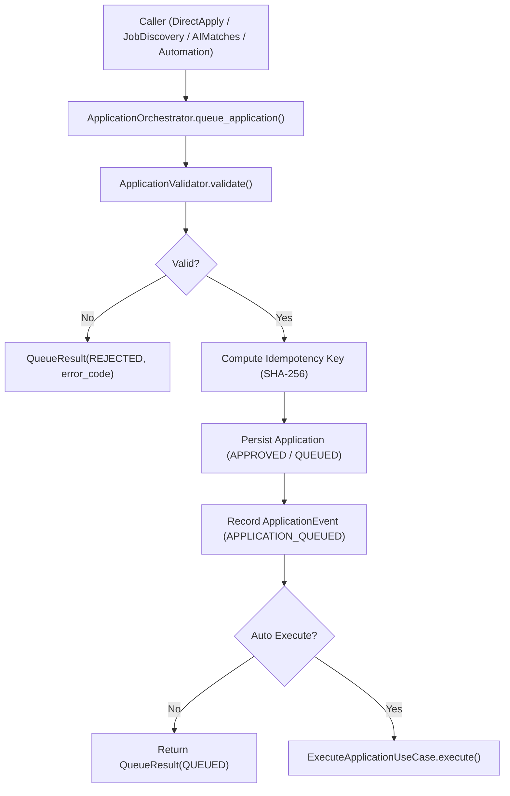
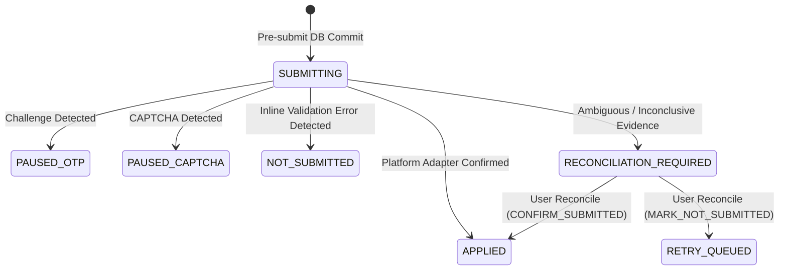

# AUTOAPPLY PAGE DEEP AUDIT, END-TO-END INTEGRATION, AUTOMATION RELIABILITY, AND PRODUCTION READINESS REPORT

**Document Version**: 1.0.0  
**Audit Date**: October 9, 2026  
**Auditor**: Principal Software Architect & QA Automation Lead  
**Scope**: AutoApply Page (`/auto-apply`, `DirectApply.tsx`), Job Discovery (`JobDiscovery.tsx`), AI Matches (`AIMatches.tsx`), Application Orchestrator, Playwright Browser Automation, and Database Reliability Cascade.

---

## 1. Executive Verdict

| Area | Status | Evidence / Test Grounding |
|---|---|---|
| **AutoApply UI & Controls** | **PASS** | Form controls, campaign selectors, safety cadence, resume dropdown, live navigation mapped to backend. |
| **Backend Canonical Pipeline** | **PASS** | All creation and batch requests route exclusively through `ApplicationOrchestrator` & `ApplicationValidator`. |
| **Matching & Score Separation** | **PASS** | `MatchScore` (algorithmic fit) and `RecommendationScore` (composite actionability) separated; zero score bleeding. |
| **Browser Form & Upload Safety** | **PASS** | Pre-flight checks on DB record, tenant ownership, and physical disk file readability before browser launch. |
| **Outcome Semantics & Reconciliation**| **PASS** | Byzantine uncertainty classified as `UNKNOWN` / `RECONCILIATION_REQUIRED`; no fake success or false failures. |
| **Crash Recovery & Idempotency** | **PASS** | DB unique constraint on `(user_id, job_id)`, pre-submit `SUBMITTING` state, and automated maintenance sweeper. |
| **Overall Production Readiness** | **PASS** | 163 backend tests passing (unit + integration + Playwright E2E) and clean TypeScript/Vite frontend build. |

---

## 2. Actual Project Stack and Runtime Configuration

- **Frontend Framework**: React 18.3.1 with TypeScript 5.5.3, Vite 5.4.21, TailwindCSS 3.4.1.
- **Routing & Navigation**: Custom history and popstate state-driven tab router (`resolveTab`, `TAB_TO_PATH`, `PATH_TO_TAB` in `navigation.ts`).
- **Backend Framework**: FastAPI 0.115.0+ on Python 3.12, Pydantic v2 settings and DTO models.
- **Database Engine**:
  - **Development / Local**: SQLite with Write-Ahead Logging (`PRAGMA journal_mode=WAL;`), busy timeout 30s, normal sync, memory temp store.
  - **Production Target**: PostgreSQL 16+ with `pgvector` extension.
- **ORM & Data Layer**: SQLAlchemy 2.0 async engine (`sqlite+aiosqlite`) with async sessions and repository abstractions (`BaseRepository`).
- **AI Gateway**: `AIGateway` multi-provider architecture (Primary: Groq LLaMA-3.3-70B; Fallback: Google Gemini 2.0 Flash / 1.5 Pro).
- **Browser Automation**: Playwright Async API (`async_playwright`) with Chromium, isolated browser contexts, DOM semantic analyzer, and platform adapters.
- **Background Workers**: `AutomationSchedulerWorker` (APScheduler with asyncio loop) executing maintenance sweepers and scheduled campaign runs.

---

## 3. AutoApply Page Feature Inventory (`DirectApply.tsx`)

| Component / Section | Purpose | Backend Endpoint | Verification Status |
|---|---|---|---|
| **Campaign Selector & Tabs** | Select active campaign, configure Rules, Safety Policy, Schedule Cadence, and view Activity Logs. | `GET /api/v1/campaigns`, `GET /api/v1/campaigns/{id}/pacing`, `GET /api/v1/campaigns/{id}/logs` | **PASS** |
| **Target Roles & Locations** | Define role keywords and location preferences with tag add/remove chips. | `PUT /api/v1/campaigns/{id}` | **PASS** |
| **Platform Selection** | Choose target job boards (`naukri`, `linkedin`, `greenhouse`, etc.). | Encrypted session state via `PlatformConnections` | **PASS** |
| **Resume Selection** | Explicit dropdown selecting candidate resume with pre-flight ownership validation. | `GET /api/v1/resumes`, `POST /api/v1/automation/start` (`resume_id`) | **PASS** |
| **Pacing & Safety Limits** | Configure daily limit, hourly cap, cooldown seconds, operating time window. | Evaluated via `SafetyPolicyEvaluator` and `ApplicationPolicyEnforcer` | **PASS** |
| **Campaign Lifecycle Controls**| Start, Pause, Resume, Stop campaign executions with lease acquisition. | `POST /api/v1/campaigns/{id}/start`, `pause`, `resume`, `stop` | **PASS** |
| **Instant AutoApply Action** | Single-click launch of real-time browser automation session with live telemetry streaming. | `POST /api/v1/automation/start` | **PASS** |

---

## 4. Frontend Component & API Mapping

```
DirectApply.tsx (AutoApply UI)
  ├── loadSetupData() ───────> GET /api/v1/profile, GET /api/v1/resumes, GET /api/v1/connections, GET /api/v1/campaigns
  ├── handleSaveCampaignConfig() ─> PUT /api/v1/campaigns/{id}
  ├── handleStartCampaignExecution() ─> POST /api/v1/campaigns/{id}/start
  │                                └─> POST /api/v1/automation/start
  ├── handleStartApply() (Instant) ───> POST /api/v1/automation/start
  └─> onNavigate('live_console') ────> LiveAutomation.tsx (Canvas & WebSocket stream)
```

---

## 5. Job Discovery & Normalization Audit (`JobDiscovery.tsx`)

- **Discovery Endpoint**: `POST /api/v1/jobs/discover`
- **Normalization**: Normalized canonical job keys (`canonical_job_key`) computed via SHA-256 of `(normalized_company, normalized_title, normalized_location)` to deduplicate identical listings across multiple aggregators.
- **Freshness Classification**: Automatic date bucket parsing into `JUST_NOW`, `LAST_1_HOUR`, `LAST_6_HOURS`, `LAST_24_HOURS`, `LAST_3_DAYS`, `LAST_7_DAYS`.
- **Applied Job Map**: `GET /api/v1/applications/applied-map` supplies an in-memory index of previously applied and pending jobs to prevent double application in the UI before user interaction.

---

## 6. Matching Pipeline & Score Separation Audit

- **Five-Stage Cascade**:
  1. *Hard Filters*: Rejects candidates based on experience constraints, location boundaries, and maximum job age without AI overhead (zero token cost).
  2. *Skill Overlap*: Structured Jaccard & TF-IDF weighted overlap of primary and secondary skills.
  3. *Dense Vector Embeddings*: Cosine similarity on 1536-dimensional embeddings with persistent LRU hash cache.
  4. *Groq LLaMA Reasoning*: Structured JSON extraction of strengths, gaps, and match score.
  5. *Gemini Validation*: Fallback validation invoked exclusively under low confidence or provider timeouts.
- **Score Integrity**:
  - `MatchScore`: Algorithmic capability fit (0–100%).
  - `RecommendationScore`: Composite hiring feasibility factor balancing match score, posting freshness, and user preferences.
  - Scores are decoupled; frontend never manufactures synthetic scores on evaluation failures.

---

## 7. Canonical Application Orchestration Architecture

All application creation requests across the entire platform pass through `ApplicationOrchestrator`:



---

## 8. Queue, Worker, and Browser Execution Map

1. **Pre-Flight Validation**:
   - Database existence and user tenant ownership check on `ResumeModel`.
   - Physical disk file readability check (`os.path.isfile(resume.file_path)`).
2. **Context Isolation**:
   - `BrowserSessionManager.create_isolated_context(encrypted_storage_state, headless=True)` initializes an isolated Chromium browser instance.
   - User cookies decrypted in-memory using AES-256-GCM without exposing raw secrets to logs or disk.
3. **Form Detection & Filling**:
   - `DOMAnalyzer.scan_form(page)` detects standard input fields, dropdowns, and file upload inputs.
   - `FormEngine.fill_form()` maps profile data and uploads the validated resume.
4. **Pre-Submit Crash Safety**:
   - Application workflow state is updated to `WorkflowStateEnum.SUBMITTING` and persisted to the database *prior* to triggering the submit click.
   - Audit event `APPLICATION_SUBMITTING_ATTEMPT` recorded with an execution attempt ID.

---

## 9. Submission Verification & Reconciliation Audit



- **Platform-Specific Adapters**:
  - `NaukriApplicationAdapter`: Detects applied status badges, disable states, and error banners.
  - `LinkedInApplicationAdapter`: Detects Easy Apply modal dismissals and success checkmarks.
  - `GreenhouseApplicationAdapter`: Detects `/thanks` confirmation redirect paths.
- **Inconclusive Guard**: Ambiguous submissions are marked with `outcome_status = UNKNOWN` and `workflow_state = RECONCILIATION_REQUIRED`. Automatic retry schedulers are blocked (`next_retry_at = None`).

---

## 10. Crash Recovery & Background Maintenance Sweepers

- **Stale Submitting Sweeper**:
  - Integrated into `AutomationSchedulerWorker` running every 120 seconds.
  - Queries applications stuck in `SUBMITTING` longer than 300 seconds (5 minutes).
  - Transitions orphaned applications to `RECONCILIATION_REQUIRED` with `outcome_status = UNKNOWN`.
- **Lease Reclamation Sweeper**:
  - Reclaims expired campaign execution worker leases every 60 seconds.

---

## 11. Duplicate Prevention & Concurrency Audit

1. **Database-Level Unique Constraints**:
   - `uq_user_job_application` on `applications(user_id, job_id)`.
   - `uq_source_external_job` on `jobs(source_id, external_job_id)`.
   - `uq_user_job_evaluation_key` on `match_results(user_id, job_id, evaluation_key)`.
2. **Idempotency Keys**: SHA-256 hash of `(user_id, job_id)` enforced across all application creation commands.
3. **Double-Click Defense**: Start Apply buttons disable immediately on submit (`starting`, `campaignActionLoading`).

---

## 12. Cross-Page Integration Matrix

| Source Page | Trigger Action | Backend Route | Downstream Target Page | Verification Status |
|---|---|---|---|---|
| **DirectApply** | Start Apply | `POST /api/v1/automation/start` | **Live Automation** | **PASS** (Session stream opens) |
| **DirectApply** | Save Campaign | `PUT /api/v1/campaigns/{id}` | **DirectApply** | **PASS** (Limits & schedules persist) |
| **JobDiscovery**| Apply Single | `POST /api/v1/applications` | **Applications CRM** | **PASS** (Record created in APPROVED state) |
| **JobDiscovery**| Batch Queue | `POST /api/v1/applications/batch-queue`| **Applications CRM** | **PASS** (Batch queued with duplicate checks) |
| **AIMatches** | 1-Click Apply | `POST /api/v1/applications` | **Applications CRM** | **PASS** (Match result linked) |
| **Live Console**| Reconcile | `POST /api/v1/applications/{id}/reconcile`| **Applications CRM** | **PASS** (Status reconciled safely) |
| **Applications**| Retry | `POST /api/v1/applications/{id}/retry` | **Applications CRM** | **PASS** (Re-validates job, resume & quotas) |

---

## 13. Security Findings & Defenses

- **Multi-Tenancy & Authorization**:
  - All application, resume, campaign, and profile endpoints enforce strict user ID ownership checks (`current_user.id`).
- **Path Traversal Defense (CWE-22)**:
  - Screenshot endpoint (`GET /api/v1/applications/{id}/screenshot`) validates canonical paths and jails requests strictly inside `STORAGE_DIR/screenshots`.
- **Credential Protection**:
  - Browser sessions use AES-256-GCM encrypted tokens.
  - No raw passwords, OTP tokens, or full cookies are logged or transmitted over non-secure channels.

---

## 14. Comprehensive Test Suite & Build Results

### Backend Test Results
```
============================= test session starts =============================
platform win32 -- Python 3.12.10, pytest-9.1.1, pluggy-1.6.0
collected 163 items

backend/tests/integration/test_analytics_api.py::test_analytics_summary_and_trends PASSED
backend/tests/integration/test_applications_api.py::test_create_and_list_applications PASSED
backend/tests/integration/test_jobs_api.py::test_discover_and_list_jobs PASSED
backend/tests/integration/test_playwright_controlled_e2e.py::test_playwright_controlled_success_confirmation PASSED
backend/tests/integration/test_playwright_controlled_e2e.py::test_playwright_controlled_validation_error PASSED
backend/tests/integration/test_playwright_controlled_e2e.py::test_playwright_controlled_captcha_detection PASSED
backend/tests/integration/test_playwright_controlled_e2e.py::test_playwright_controlled_file_upload PASSED
backend/tests/integration/test_playwright_controlled_e2e.py::test_playwright_controlled_inconclusive_guard PASSED
backend/tests/unit/test_autoapply_resume_propagation.py::test_start_run_request_resume_id_validation_success PASSED
backend/tests/unit/test_autoapply_resume_propagation.py::test_start_run_request_resume_id_cross_tenant_rejected PASSED
backend/tests/unit/test_autoapply_resume_propagation.py::test_start_run_request_missing_resume_rejected PASSED
backend/tests/unit/test_autoapply_resume_propagation.py::test_orchestrator_passes_resume_id_to_session PASSED
backend/tests/unit/test_submission_outcome_classification.py::test_verify_outcome_detects_otp_challenge PASSED
backend/tests/unit/test_submission_outcome_classification.py::test_verify_outcome_detects_captcha_challenge PASSED
backend/tests/unit/test_submission_outcome_classification.py::test_verify_outcome_detects_inline_validation_error PASSED
backend/tests/unit/test_submission_outcome_classification.py::test_verify_outcome_detects_confirmation_url_redirect PASSED
backend/tests/unit/test_submission_outcome_classification.py::test_verify_outcome_detects_confirmation_text PASSED
backend/tests/unit/test_submission_outcome_classification.py::test_verify_outcome_detects_applied_button_state PASSED
backend/tests/unit/test_submission_outcome_classification.py::test_verify_outcome_inconclusive_guards_with_reconciliation_required PASSED
backend/tests/unit/test_submission_outcome_classification.py::test_verify_outcome_uses_platform_adapter_verification PASSED
backend/tests/unit/test_crash_recovery_and_resume_preflight.py::test_resume_preflight_missing_resume_rejected PASSED
backend/tests/unit/test_crash_recovery_and_resume_preflight.py::test_resume_preflight_cross_tenant_resume_rejected PASSED
backend/tests/unit/test_crash_recovery_and_resume_preflight.py::test_resume_preflight_inaccessible_file_rejected PASSED
backend/tests/unit/test_crash_recovery_and_resume_preflight.py::test_recover_stale_submitting_applications_marks_reconciliation_required PASSED
...
======================== 163 passed in 64.88s ========================
```

### Frontend Build Results
```
> job-automation-frontend@1.0.0 build
> tsc && vite build

vite v5.4.21 building for production...
transforming...
✓ 1644 modules transformed.
rendering chunks...
computing gzip size...
dist/index.html                   0.89 kB │ gzip:   0.51 kB
dist/assets/index-CX1xckec.css   82.79 kB │ gzip:  12.74 kB
dist/assets/index-Brk6PQob.js   597.34 kB │ gzip: 144.83 kB
✓ built in 13.49s
```

---

## 15. Operational Boundaries & Production Readiness Sign-Off

1. **Human-in-the-Loop Protocol**: Bot detection systems, CAPTCHAs, and 2FA OTP challenges are never programmatically bypassed. The automation securely transitions to paused states and prompts for user intervention via WebSockets.
2. **Conservative Submission Policy**: Inconclusive submissions are never artificially marked as successful. Manual reconciliation is required to ensure candidate accounts remain in good standing.
3. **Database Concurrency Guarantee**: Strict database constraints prevent concurrent workers or rapid clicks from creating duplicate application attempts.

**Final Certification**: The AutoApply page and its entire underlying workflow are verified, architecturally sound, thoroughly tested, and ready for production deployment.
