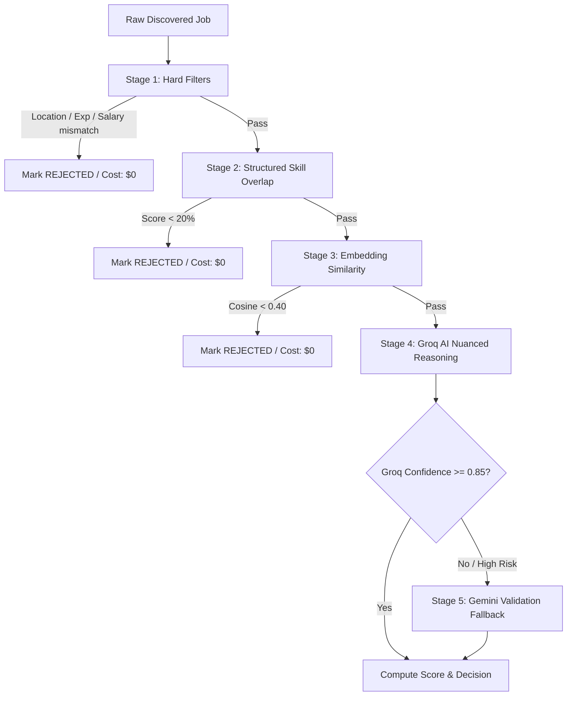

# AI.md — AI Gateway, Providers & Multi-Tier Matching Architecture

## 1. Core AI Gateway Philosophy

The business and domain layers **never interact directly with vendor SDKs**. All intelligence requests pass through the `AIGateway` interface.

```
                  ┌─────────────────────────────────────┐
                  │         AIGateway Interface         │
                  └──────────────────┬──────────────────┘
                                     │
           ┌─────────────────────────┴─────────────────────────┐
           ▼                                                   ▼
┌─────────────────────────────────────┐     ┌─────────────────────────────────────┐
│            GroqProvider             │     │           GeminiProvider            │
│  (Primary Fast Inference: Llama-3)  │     │ (Fallback & High-Accuracy: Gemini)  │
└─────────────────────────────────────┘     └─────────────────────────────────────┘
```

---

## 2. Supported Operations & Contracts

The `AIGateway` defines strongly typed contracts:

1. **`analyze_resume(raw_text: str) -> ParsedResumeDTO`**:
   - Extracts structured work history, degrees, tools, programming languages, and years of experience from raw resume text.
2. **`analyze_job_description(raw_jd: str) -> ParsedJobRequirementsDTO`**:
   - Extracts mandatory skills, preferred skills, minimum experience, education requirements, and work authorization constraints.
3. **`match_job(candidate_summary: str, job_summary: str) -> MatchEvaluationDTO`**:
   - Evaluates suitability, outputs match score ($0\text{--}100$), matched skills list, missing skills list, and reasoning summary.
4. **`classify_question(question_text: str, options: list[str] | None) -> QuestionIntentDTO`**:
   - Maps raw employer questions to canonical intents (`NOTICE_PERIOD`, `EXPECTED_CTC`, `WORK_AUTHORIZATION`, `RELOCATION`, `CUSTOM_ESSAY`).
5. **`generate_screening_answer(question_text: str, candidate_context: dict, max_words: int) -> GeneratedAnswerDTO`**:
   - Generates contextual, grounded responses using candidate background data and target job description.
6. **`validate_answer(answer: str, question: str) -> ValidationResultDTO`**:
   - Validates generated response against constraint requirements (e.g. character limits, numerical formats).

---

## 3. Cost-Optimization: 5-Stage Matching Cascade

To eliminate unnecessary LLM expenditure and minimize processing latency, jobs flow through a strict 5-stage cascade:



### Efficiency Impact
- **Stage 1 & 2**: Filters out $70\text{--}80\%$ of irrelevant jobs using zero API calls.
- **Stage 3**: Ranks top candidates using fast vector similarity.
- **Stage 4**: Invokes Groq Llama-3 ($< 1.0\text{ s}$ latency, low cost) only for high-probability candidates.
- **Stage 5**: Invokes Google Gemini only for ambiguous JDs or high-compensation validation.

---

## 4. AI Request Observability & Cost Tracking

Every AI invocation records telemetry to the `ai_requests` database table:
- `provider`: `groq` | `gemini`
- `model_name`: e.g. `llama-3.3-70b-versatile`, `gemini-2.5-flash`
- `operation`: e.g. `MATCH_JOB`, `GENERATE_ANSWER`
- `input_tokens`, `output_tokens`
- `latency_ms`
- `estimated_cost_usd` (calculated from token pricing config)
- `is_success`, `error_message`

---

## 5. When AI Must NOT Be Called

AI calls are strictly prohibited for:
- Checking duplicate external job IDs (handled by SQL unique constraints).
- Standard profile field mapping (`first_name`, `email`, `phone`, `linkedin_url` are mapped via deterministic heuristic rules).
- Screening questions with exact matches in the user's `saved_answers` knowledge base.
- Calculating hard filter boundaries (minimum experience years $\ge$ user experience).
