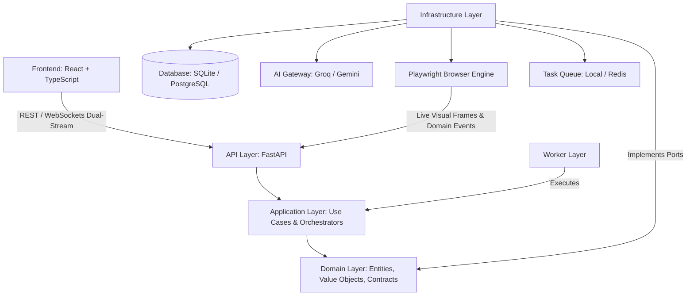
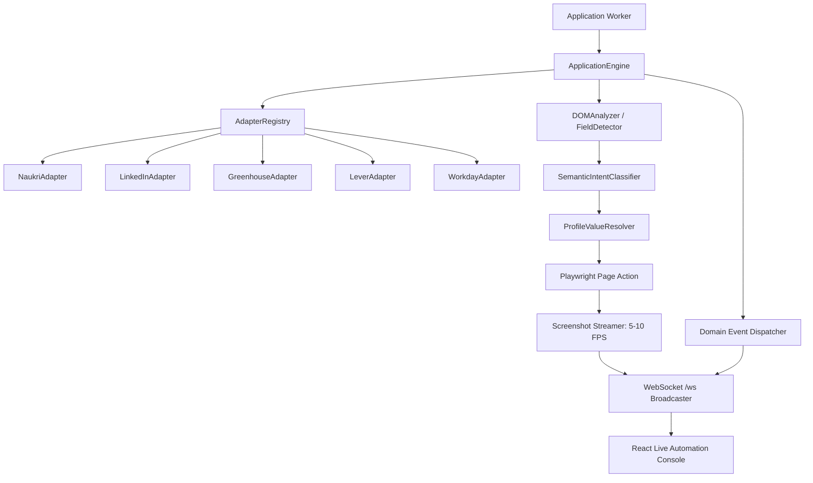
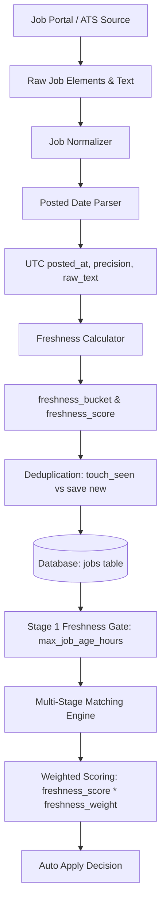
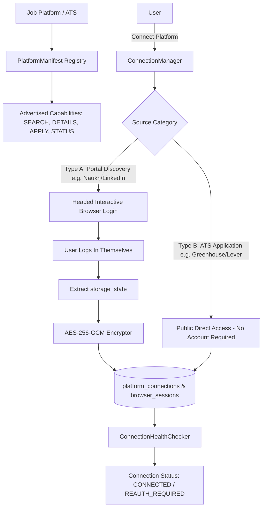

# ARCHITECTURE.md — System & Technical Architecture

## 1. Architectural Style: Clean / Hexagonal Architecture

The platform strictly follows Clean Architecture (Ports & Adapters). Dependencies flow inward towards domain logic.



---

## 2. Layer Definitions & Boundaries

### 2.1 API Layer (`app/api/`)
- Exposes RESTful HTTP endpoints and WebSocket event streams (`/api/v1/ws`).
- Handles request serialization, JSON schema validation via Pydantic v2, JWT authentication, and live control commands (`PAUSE`, `RESUME`, `TAKE_CONTROL`, `STOP`).
- **Rule**: No business logic, direct DB queries, or browser invocations allowed in API route handlers.

### 2.2 Application Layer (`app/application/`)
- Encapsulates application-specific use cases, orchestrating flows between domain repositories, AI gateways, browser engines, and task queues.
- Sub-modules:
  - `profile/`: Candidate profile & resume management use cases.
  - `jobs/`: Job discovery, normalization, and deduplication workflows.
  - `matching/`: Multi-stage evaluation & decision pipeline.
  - `applications/`: Form detection, field resolution, and submission orchestration.
  - `automation/`: Schedule execution, browser session lifecycle, and live event dispatcher.

### 2.3 Domain Layer (`app/domain/`)
- Contains pure enterprise business models, domain services, value objects, and abstract repository/gateway interfaces.
- **Rule**: Completely independent of third-party libraries (SQLAlchemy, Playwright, Groq, Redis, etc.).

### 2.4 Infrastructure Layer (`app/infrastructure/`)
- Provides concrete implementations for all domain ports:
  - `database/`: SQLAlchemy 2.0 ORM mappings, session lifecycle, and repository implementations.
  - `ai/`: AI Gateway, `GroqProvider`, `GeminiProvider`, and prompt templates.
  - `browser/`: Playwright browser lifecycle manager, visual screenshot streamer, DOM analyzer, form engine, and platform-specific adapters.
  - `queue/`: Local task queue (Development) and Redis/Celery queue (Production).
  - `storage/`: Local disk and S3-compatible object storage.

### 2.5 Worker Layer (`app/workers/`)
- Decoupled asynchronous background workers:
  - **Discovery Worker**: Executes periodic job extraction using browser adapters.
  - **Matching Worker**: Runs multi-stage scoring and decision policy on discovered jobs.
  - **Application Worker**: Manages browser automation for approved applications and emits live frame/timeline events.
  - **Scheduler Worker**: Evaluates user-defined automation schedules and dispatches tasks.

---

## 3. Detailed Component Architecture

### 3.1 AI Gateway Architecture
```mermaid
graph LR
    App[Application Use Case] --> Gateway[AIGateway Interface]
    Gateway --> Groq[GroqProvider (Primary / Fast Llama-3)]
    Gateway --> Gemini[GeminiProvider (Fallback / Complex)]
    Groq -.->|Fallback on 429 / Error| Gemini
    Gateway --> Tracker[AI Cost & Usage Tracker]
    Tracker --> DB[(ai_requests Table)]
```

### 3.2 Browser, Adapter & Live Streaming Engine


### 3.3 Job Freshness & Normalization Pipeline


### 3.4 Platform Connection, Session & Capability Architecture


---

## 4. Multi-Tenant Session & Security Model

```mermaid
graph TD
    User[Candidate] -->|Connects Platform| BrowserAuth[Headed Auth Flow]
    BrowserAuth --> StorageState[Playwright StorageState (Cookies/Tokens)]
    StorageState --> Crypto[AES-256-GCM Encryptor]
    Crypto --> EncryptedDB[(browser_sessions.encrypted_storage_state)]
    
    Worker[Browser Worker] --> Decrypt[Decrypt Session on Task Start]
    Decrypt --> Context[Isolated BrowserContext]
    Context --> JobApply[Automated Application]
```

---

## 5. Technology Evolution Path

| Layer | Development (Phase 1) | Production (Phase 7+) |
|---|---|---|
| **Database** | SQLite + WAL Mode (`aiosqlite`) | PostgreSQL 16+ (`asyncpg`) |
| **Vectors** | Local Cosine Similarity (Scikit-Learn/In-Memory) | `pgvector` HNSW index |
| **Worker Queue** | `LocalTaskQueue` (Asyncio Task Pool) | Redis + Celery / ARQ |
| **Event Bus** | In-Process Async Event Dispatcher | Redis PubSub |
| **File Storage** | Local filesystem (`./storage`) | AWS S3 / MinIO Object Store |
| **Live Stream** | In-Process WebSocket Broadcaster | Redis PubSub WebSocket Cluster |

---

## 6. Dashboard vs. Analytics Architectural Separation

The platform enforces a strict separation of concerns between operational awareness and historical strategic analysis:

### 6.1 Dashboard ("Operational Command Center")
- **Responsibility**: "What do I need to know or do right now?"
- **State**: Live, real-time, operational.
- **Key Modules**:
  - Active Campaign Run Status (`RUNNING`, `PAUSED`, `IDLE`).
  - Active Execution Target & Platform.
  - Interactive Operational Controls (`PAUSE`, `RESUME`, `STOP`).
  - Active Human-in-the-Loop Blockers (`PAUSED_OTP`, `PAUSED_CAPTCHA`, `APPROVAL_REQUIRED`).
  - Platform Connection & Health Status.
  - Daily Safe Application Quota (`today_applications / effective_daily_limit`).
  - User-Scoped Today's Discovered & Matched Jobs.
  - Actionable Job Queue & Recent Application Activity Log.
- **Strictly Excluded**: Historical time-series charts, lifetime application aggregates, deep resume comparisons, and matching strategy weight sliders.

### 6.2 Analytics ("Historical Performance & Strategic Decision Workspace")
- **Responsibility**: "How well is my job search strategy performing over time?"
- **State**: Purely read-only, historical, aggregated across selectable date ranges (`Today`, `7D`, `30D`, `90D`, `Custom`, `All Time`).
- **Strictly Enforced Rules**:
  1. **Read-Only Strategic Surface**: No mutation buttons or execution triggers. Direct links route users to dedicated settings pages (e.g. `Configure Matching Strategy →`).
  2. **Full 7-Stage Conversion Funnel**:
     - `Discovered`: Jobs extracted/associated with user campaigns.
     - `AI Matched`: Jobs passing multi-stage cascade criteria.
     - `Applications Triggered`: Applications queued or initiated.
     - `Confirmed Submissions`: Applications successfully submitted on platform/ATS.
     - `Employer Responses`: Positive or neutral initial responses/acknowledgments.
     - `Interviews`: Scheduled screens, technical rounds, or hiring manager conversations.
     - `Offers`: Formal job offers received.
  3. **Decoupled Executive Outcome KPIs**:
     - `Confirmed Submissions`
     - `Employer Response Rate` (`total_responded / total_submitted`)
     - `Interview Rate` (`total_interviewed / total_submitted`)
     - `Offer Rate` (`total_offered / total_submitted`)
  4. **Observational Performance Integrity**:
     - Strictly observational comparison without pseudo-scientific "A/B Testing", "Experiment", "Winner", or "Statistically Significant" claims.
     - Labeled as `Resume Performance Comparison` with `Highest Observed Interview Rate` / `Best Observed Outcome` alongside rigorous sample sizes.
