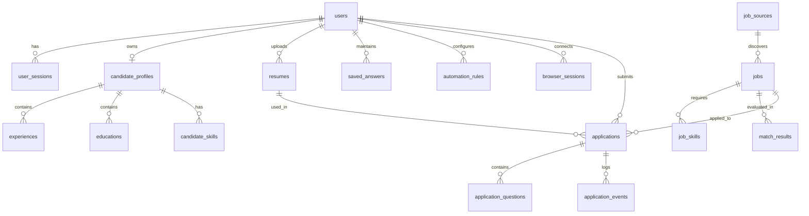

# DATABASE.md — Database Schema, Models & Migration Strategy

## 1. Overview & Multi-Engine Compatibility

The persistence layer is architected with **SQLAlchemy 2.0 ORM** and **Alembic** migrations.
- **Development Engine**: SQLite 3 with Write-Ahead Logging (`PRAGMA journal_mode=WAL;`) and busy timeout (`PRAGMA busy_timeout=5000;`) to support concurrent async worker execution.
- **Production Engine**: PostgreSQL 16+ with native connection pooling (`asyncpg`) and `pgvector` for semantic search.
- **Compatibility Rule**: All schemas utilize standard generic SQLAlchemy types (`DateTime(timezone=True)`, `JSON`, `String`, `Integer`, `Boolean`, `Numeric`).

---

## 2. Entity Relationship Diagram (ERD)

---

## 3. Detailed Schema Definitions

### 3.1 Auth Domain
- **`users`**:
  - `id` (UUID / String, PK)
  - `email` (String, Unique, Indexed)
  - `hashed_password` (String, Not Null)
  - `full_name` (String)
  - `is_active` (Boolean, Default True)
  - `is_superuser` (Boolean, Default False)
  - `created_at` (DateTime TZ)
  - `updated_at` (DateTime TZ)
- **`user_sessions`**:
  - `id` (UUID / String, PK)
  - `user_id` (FK `users.id`, Indexed)
  - `jwt_token_hash` (String, Indexed)
  - `user_agent` (String)
  - `ip_address` (String)
  - `expires_at` (DateTime TZ)
  - `created_at` (DateTime TZ)

### 3.2 Candidate Profile Domain
- **`candidate_profiles`**:
  - `id` (UUID, PK)
  - `user_id` (FK `users.id`, Unique, Indexed)
  - `headline` (String)
  - `summary` (Text)
  - `phone` (String)
  - `location` (String)
  - `current_ctc` (Numeric)
  - `expected_ctc` (Numeric)
  - `currency` (String, Default 'INR')
  - `notice_period_days` (Integer)
  - `total_experience_months` (Integer)
  - `work_authorization` (String)
  - `relocation_preference` (Boolean)
  - `remote_preference` (String) # 'remote', 'hybrid', 'onsite', 'any'
  - `created_at`, `updated_at` (DateTime TZ)
- **`experiences`**:
  - `id` (UUID, PK), `profile_id` (FK `candidate_profiles.id`), `company_name` (String), `title` (String), `location` (String), `start_date` (Date), `end_date` (Date, Nullable), `is_current` (Boolean), `description` (Text)
- **`educations`**:
  - `id` (UUID, PK), `profile_id` (FK `candidate_profiles.id`), `institution` (String), `degree` (String), `field_of_study` (String), `start_year` (Integer), `end_year` (Integer), `grade` (String)
- **`candidate_skills`**:
  - `id` (UUID, PK), `profile_id` (FK `candidate_profiles.id`), `skill_name` (String, Indexed), `years_experience` (Numeric), `is_primary` (Boolean)
- **`resumes`**:
  - `id` (UUID, PK), `user_id` (FK `users.id`, Indexed), `label` (String), `target_role` (String), `file_path` (String), `file_name` (String), `mime_type` (String), `raw_text` (Text), `is_default` (Boolean), `created_at` (DateTime TZ)
- **`saved_answers`**:
  - `id` (UUID, PK), `user_id` (FK `users.id`, Indexed), `canonical_intent` (String, Indexed), `question_pattern` (String), `answer_text` (Text), `is_verified` (Boolean), `created_at`, `updated_at` (DateTime TZ)

### 3.3 Job Catalog Domain
- **`job_sources`**:
  - `id` (UUID, PK), `source_type` (String, Unique, e.g. 'naukri', 'linkedin', 'greenhouse'), `base_url` (String), `is_active` (Boolean), `rate_limit_per_min` (Integer)
- **`jobs`**:
  - `id` (UUID, PK)
  - `source_id` (FK `job_sources.id`, Indexed)
  - `external_job_id` (String, Indexed)
  - `title` (String, Indexed)
  - `company` (String, Indexed)
  - `location` (String, Indexed)
  - `min_experience_years` (Numeric)
  - `max_experience_years` (Numeric)
  - `min_salary` (Numeric)
  - `max_salary` (Numeric)
  - `salary_currency` (String)
  - `employment_type` (String)
  - `apply_url` (Text)
  - `raw_description` (Text)
  - `parsed_requirements` (JSON)
  - `embedding` (JSON in Dev / Vector(1536) in Prod)
  - `is_active` (Boolean, Default True)
  - `posted_at` (DateTime TZ, Nullable, Indexed) # Normalized UTC time of job publication
  - `first_seen_at` (DateTime TZ, Not Null, Indexed) # Ingestion time in ApplyFlow
  - `last_seen_at` (DateTime TZ, Not Null, Indexed) # Most recent scraper discovery scan
  - `raw_posted_text` (String, Nullable) # Raw portal text (e.g. '3 hours ago', 'Just Now')
  - `posted_at_precision` (String, Default 'unknown') # 'minute', 'hour', 'day', 'month', 'unknown'
  - `posted_at_source` (String, Default 'scraped_text') # 'json_ld', 'scraped_text', 'first_seen_fallback'
  - `freshness_bucket` (String, Default 'unknown', Indexed) # '1h', '3h', '6h', '12h', '24h', '3d', '7d', '14d', '30d', 'older'
  - `freshness_score` (Numeric, Default 50.0, Indexed) # 0-100 dynamic freshness score
  - `created_at` (DateTime TZ)
  - `updated_at` (DateTime TZ)
  - *Unique Constraint*: `(source_id, external_job_id)`

### 3.4 Matching & Policy Domain
- **`match_results`**:
  - `id` (UUID, PK)
  - `user_id` (FK `users.id`, Indexed)
  - `job_id` (FK `jobs.id`, Indexed)
  - `resume_id` (FK `resumes.id`, Nullable)
  - `overall_score` (Numeric) # 0 to 100 weighted cascade composite
  - `hard_filter_passed` (Boolean) # Stage 1 hard filter outcome (includes max_job_age_hours)
  - `skill_match_score` (Numeric)
  - `semantic_score` (Numeric)
  - `freshness_score` (Numeric, Nullable) # Freshness score at evaluation time
  - `reasoning_summary` (Text)
  - `matched_skills` (JSON)
  - `missing_skills` (JSON)
  - `decision` (String) # 'AUTO_APPLY', 'REQUIRE_APPROVAL', 'SAVE', 'SKIP', 'REJECT'
  - `ai_provider_used` (String)
  - `created_at` (DateTime TZ)
  - *Unique Constraint*: `(user_id, job_id)`

### 3.5 Platform Connection & Browser Domain
- **`platform_connections`**:
  - `id` (UUID / String, PK)
  - `user_id` (FK `users.id`, Indexed)
  - `platform` (String, Indexed) # e.g. 'naukri', 'linkedin', 'greenhouse'
  - `connection_type` (String) # 'BROWSER_SESSION', 'PUBLIC_ACCESS', 'API_TOKEN'
  - `status` (String, Indexed) # 'NOT_CONNECTED', 'CONNECTING', 'CONNECTED', 'SESSION_EXPIRED', 'REAUTH_REQUIRED'
  - `external_account_reference` (String, Nullable) # Masked email / portal user profile
  - `last_verified_at` (DateTime TZ, Nullable)
  - `created_at`, `updated_at` (DateTime TZ)
  - *Unique Constraint*: `(user_id, platform)`
- **`browser_sessions`**:
  - `id` (UUID / String, PK)
  - `connection_id` (FK `platform_connections.id`, Nullable, Indexed)
  - `user_id` (FK `users.id`, Indexed)
  - `source_id` (FK `job_sources.id`, Nullable, Indexed)
  - `encrypted_storage_state` (Text) # AES-256-GCM encrypted cookies/tokens (Zero plaintext storage)
  - `status` (String) # 'ACTIVE', 'EXPIRED', 'NEEDS_REAUTH'
  - `last_used_at` (DateTime TZ, Nullable)
  - `last_health_check_at` (DateTime TZ, Nullable)
  - `expires_at` (DateTime TZ, Nullable)
  - `created_at`, `updated_at` (DateTime TZ)
- **`applications`**:
  - `id` (UUID, PK)
  - `user_id` (FK `users.id`, Indexed)
  - `job_id` (FK `jobs.id`, Indexed)
  - `resume_id` (FK `resumes.id`)
  - `idempotency_key` (String, Unique, Indexed)
  - `workflow_state` (String, Indexed) # e.g. 'DISCOVERED', 'APPLYING', 'APPLIED', 'PAUSED_OTP'
  - `applied_at` (DateTime TZ, Nullable)
  - `failure_reason` (Text, Nullable)
  - `trace_file_path` (String, Nullable)
  - `screenshot_file_path` (String, Nullable)
  - `created_at`, `updated_at` (DateTime TZ)
  - *Unique Constraint*: `(user_id, job_id)`
- **`application_questions`**:
  - `id` (UUID, PK), `application_id` (FK `applications.id`), `question_text` (Text), `canonical_intent` (String), `answer_provided` (Text), `answered_by` (String), `confidence_score` (Numeric)
- **`application_events`**:
  - `id` (UUID, PK), `application_id` (FK `applications.id`, Indexed), `event_name` (String), `payload` (JSON), `created_at` (DateTime TZ)

### 3.6 AI Observability Domain
- **`ai_requests`**:
  - `id` (UUID, PK)
  - `user_id` (FK `users.id`, Nullable)
  - `provider` (String) # 'groq', 'gemini'
  - `model_name` (String)
  - `operation` (String) # 'MATCH_JOB', 'CLASSIFY_QUESTION', 'GENERATE_ANSWER'
  - `input_tokens` (Integer)
  - `output_tokens` (Integer)
  - `latency_ms` (Integer)
  - `estimated_cost_usd` (Numeric)
  - `is_success` (Boolean)
  - `error_message` (Text, Nullable)
  - `created_at` (DateTime TZ)
