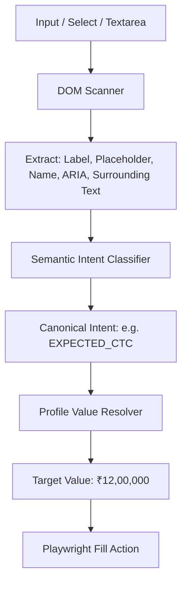

# DESIGN.md — Engineering & Design Principles

## 1. Fundamental Engineering Tenets

1. **Explicit Over Implicit**: System state, workflow transitions, and data mappings must be strictly validated and recorded.
2. **Dependency Inversion**: High-level business logic must never depend on low-level infrastructure modules. All external systems (DB, AI, Browser, Queue) are consumed through abstract domain interfaces.
3. **Fail-Safe & Isolated Execution**: A failure in one job application or one platform adapter must never crash the background worker, degrade API responsiveness, or corrupt neighboring tenant states.
4. **Configuration Over Hardcoding**: Business logic must be parameter-driven. Job roles, matching weights, AI models, rate limits, and screening answers reside in the database or environment configuration.
5. **Defense in Depth & Zero-Trust Sessions**: Plaintext passwords are never accepted or stored. All session tokens are encrypted at rest with AES-256-GCM and scoped strictly per user.

---

## 2. Design Patterns & Usage

### 2.1 Adapter Pattern (`app/infrastructure/browser/adapters/`)
- Encapsulates portal-specific DOM quirks, search queries, pagination, and multi-step flows behind uniform contracts (`BaseJobSourceAdapter` and `BaseApplicationAdapter`).
- Isolates portal UI changes to single adapter files.

### 2.2 Factory & Registry Pattern (`AdapterRegistry`)
- Centralized registry pattern to instantiate and retrieve adapters dynamically by source type:
  ```python
  adapter = adapter_registry.get(job_source.source_type)
  ```

### 2.3 Strategy Pattern (AI Gateway & Matching)
- Pluggable AI providers (`GroqProvider`, `GeminiProvider`) implement the `AIProvider` contract. The `AIGateway` switches providers based on priority, latency, or error fallback rules without altering domain use cases.

### 2.4 State Machine Pattern (Application FSM)
- Enforces valid lifecycle transitions for applications. Transitions reject invalid state changes (e.g. attempting to submit without passing through `READY_TO_SUBMIT`).

### 2.5 Unit of Work & Repository Pattern
- Decouples business logic from SQLAlchemy sessions. All data access occurs through repository interfaces (`CandidateProfileRepository`, `JobRepository`, `ApplicationRepository`).

---

## 3. Heuristic Form Detection & Semantic Field Mapping

Instead of relying on fragile CSS selectors like `#txtEmail` or `.input-phone`, the Form Engine evaluates candidates via a multi-signal heuristic:



### Signal Weights for Field Classification
1. **ARIA Label & Role**: Highest confidence ($0.95$).
2. **Associated `<label>` Tag `for` attribute**: High confidence ($0.90$).
3. **Placeholder & Input `name` / `id` attribute**: Medium-High confidence ($0.80$).
4. **Surrounding Text & Parent Container Context**: Medium confidence ($0.65$).
5. **AI Semantic Fallback**: Triggered when combined heuristic confidence $< 0.70$.

---

## 4. Temporal Freshness & Decay Principles

1. **Temporal Distinction**: `posted_at` (actual job creation at source) is strictly distinct from `first_seen_at` (time our crawler discovered it) and `last_seen_at` (time refreshed). `posted_at` is never overwritten by discovery timestamps.
2. **Deterministic Bracket Calculation**: Freshness buckets (`1h`, `3h`, `6h`, `12h`, `24h`, `3d`, `7d`, `14d`, `30d`, `older`) are derived directly from normalized UTC timestamps relative to `datetime.now(timezone.utc)`.
3. **Multi-Stage Cost Elimination**: Jobs exceeding `max_job_age_hours` are rejected immediately in Stage 1 Hard Filters, avoiding LLM token consumption entirely.
4. **Weighted Ranking Composite**: Recent postings obtain an additive weighted score bonus in Stage 4 & 5 to ensure high-priority auto-apply queue ordering.

---

## 5. Prohibited Architectural Anti-Patterns

- ❌ **Anti-Pattern 1: God Service (`JobService`)**: Placing discovery, matching, AI calls, and browser actions in one giant class.
- ❌ **Anti-Pattern 2: Domain Leaking**: Importing `playwright.async_api.Page` or `sqlalchemy.orm.Session` inside domain entities or services.
- ❌ **Anti-Pattern 3: Unhandled Headless Exceptions**: Allowing Playwright timeout exceptions to bubble up uncaught, leaving browser instances orphaned.
- ❌ **Anti-Pattern 4: Blind Auto-Apply**: Submitting applications with unverified custom questions or failing confidence thresholds without human-in-the-loop review.
- ❌ **Anti-Pattern 5: Direct AI Vendor Coupling**: Directly calling `groq.Groq()` or `google.genai.Client()` outside the `infrastructure/ai/` provider implementations.
