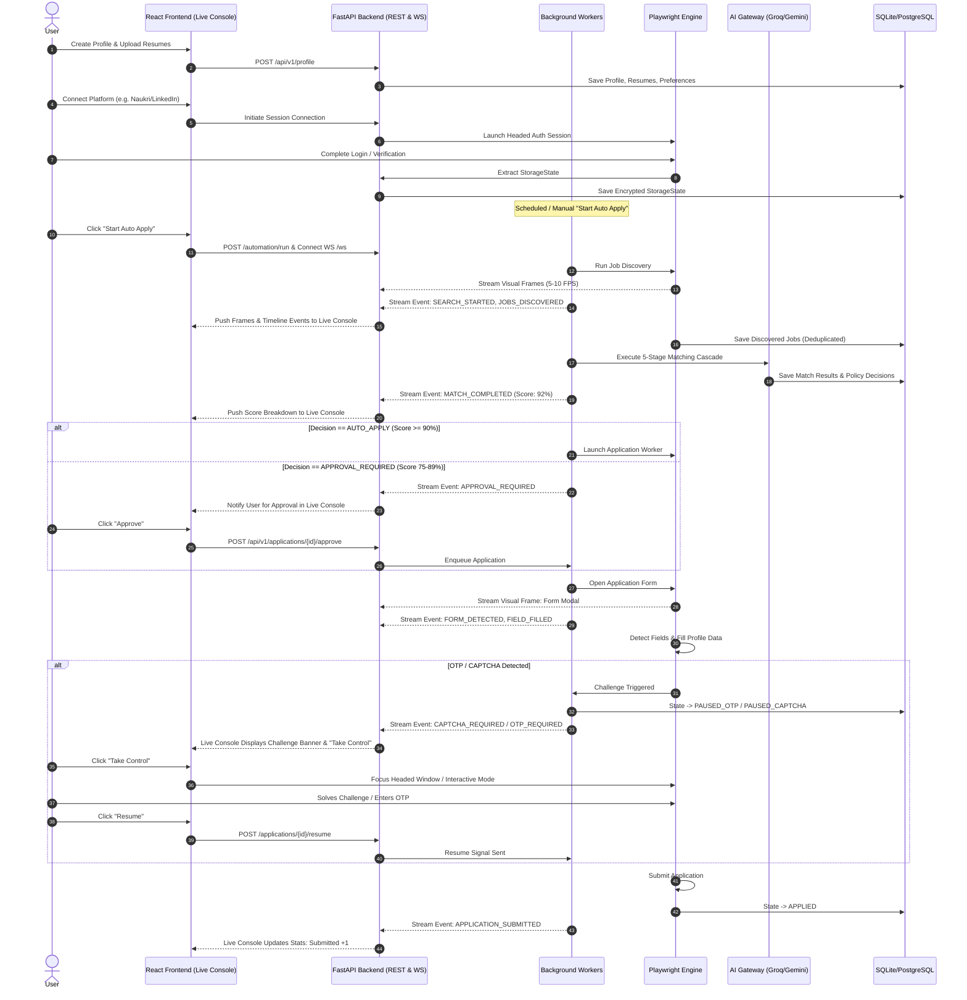
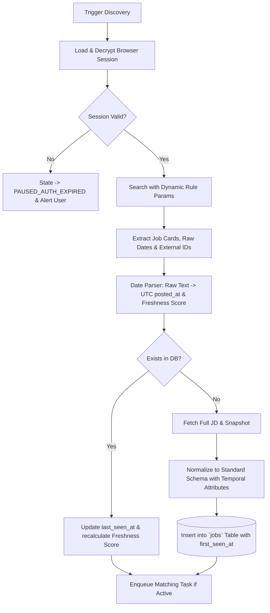
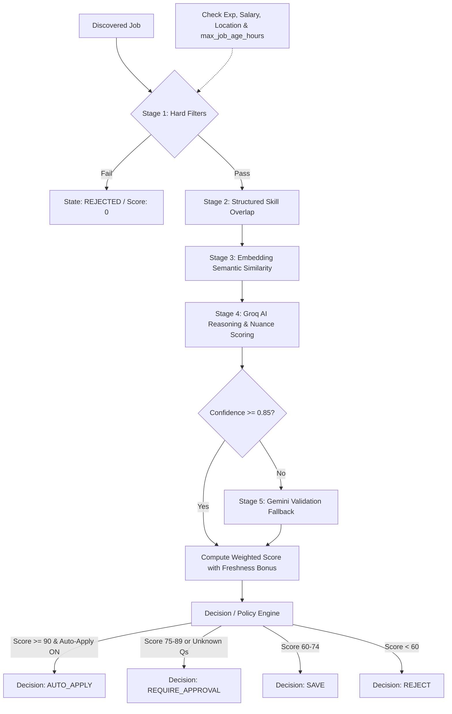
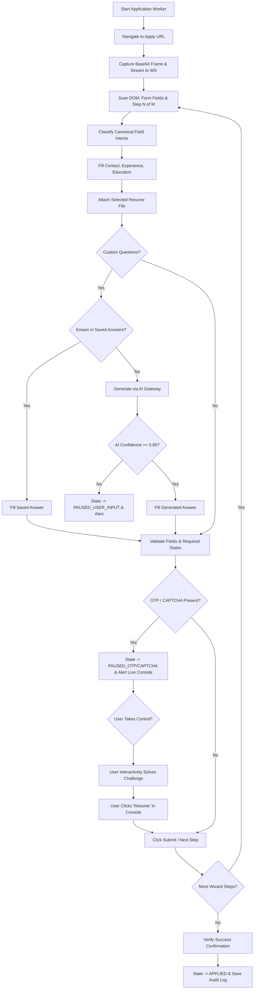

# FLOW.md — Complete End-to-End System Workflows

## 1. High-Level Lifecycle & Live Streaming Flow

---

## 2. Detailed Sub-Workflows

### 2.1 Job Discovery, Freshness Normalization & Deduplication Workflow

### 2.2 5-Stage Matching & Decision Workflow

### 2.3 Application, Live Visual Streaming & Form Automation Workflow

