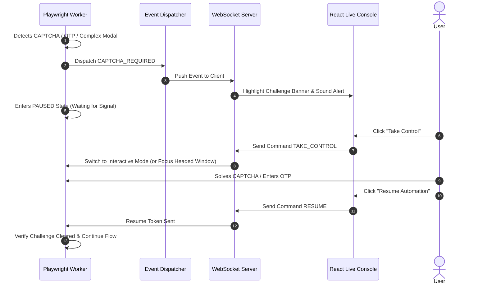

# LIVE_AUTOMATION.md — Live Automation Console & Dual-Stream Architecture

## 1. Feature Overview & Value Proposition

The **Live Automation Console** is a core, first-class capability providing real-time visibility and human control over automated browser sessions. Rather than running as an opaque background black box, the platform streams two synchronized layers to the React dashboard over WebSockets:

1. **Stream A: Live Browser Visual Stream**: Real-time periodic visual frame snapshots (5–10 FPS) showing exactly what Playwright is rendering on the target portal.
2. **Stream B: Automation Event Timeline**: Real-time domain event telemetry explaining *why* the automation engine is performing each action (e.g., applying filters, solving questions, pausing for OTP).

```
┌────────────────────────────────────────────────────────────────────────────┐
│ 🔴 LIVE AUTOMATION                                    [Pause] [Stop] [Take Control] │
├────────────────────────────────────────────────────────────────────────────┤
│                                                                            │
│  ┌──────────────────────────────────────────┐  ┌─────────────────────────┐ │
│  │                                          │  │ AUTOMATION TIMELINE     │ │
│  │         LIVE BROWSER VIEW                │  │                         │ │
│  │                                          │  │ ✓ 15:30:02 Started      │ │
│  │  Naukri.com                              │  │ ✓ 15:30:05 Search loaded│ │
│  │  Search: Senior Data Engineer            │  │ ✓ 15:30:07 Filter: Pune │ │
│  │  Location: Pune                          │  │ ✓ 15:30:10 37 Jobs found│ │
│  │  Experience: 3-6 Years                   │  │ ✓ 15:30:14 Matched: 14  │ │
│  │                                          │  │ → 15:30:18 Filling Form │ │
│  │                                          │  │                         │ │
│  └──────────────────────────────────────────┘  └─────────────────────────┘ │
│                                                                            │
├────────────────────────────────────────────────────────────────────────────┤
│ Current Action: Filling notice period (30 Days)                            │
│ Jobs Discovered: 37 | Matched: 14 | Submitted: 3 | Requires Approval: 1     │
└────────────────────────────────────────────────────────────────────────────┘
```

---

## 2. Dual-Stream Architecture

```
                    ┌────────────────────────────────────────┐
                    │       Playwright Browser Worker        │
                    └───────┬────────────────────────┬───────┘
                            │                        │
       Visual Frame Stream  │                        │  Automation Domain Events
      (Base64 JPEG Snapshots)│                       │ (Structured JSON Events)
                            ▼                        ▼
                ┌──────────────────────┐  ┌──────────────────────┐
                │   Screenshot Stream  │  │   Event Dispatcher   │
                │ (5-10 FPS Throttled) │  │  (Domain Lifecycle)  │
                └───────────┬──────────┘  └──────────┬───────────┘
                            │                        │
                            └───────────┬────────────┘
                                        │ WebSocket Frame
                                        ▼
                             ┌──────────────────────┐
                             │  FastAPI /ws Router  │
                             └──────────┬───────────┘
                                        │ Real-time Stream
                                        ▼
                             ┌──────────────────────┐
                             │ React Web Dashboard  │
                             │ ├── LiveBrowserView  │
                             │ ├── TimelineViewer   │
                             │ └── ControlPanel     │
                             └──────────────────────┘
```

---

## 3. Standardized Event Taxonomy

Events are categorized into clear domain namespaces and translated into human-friendly messages:

### 3.1 Browser Lifecycle Events
- `PAGE_OPENED`: Browser tab initialized.
- `PAGE_NAVIGATED`: Portal URL loaded.
- `PAGE_LOADED`: DOM and network idle reached.

### 3.2 Job Discovery & Filtering Events
- `SEARCH_STARTED`: Search keyword query submitted.
- `FILTER_APPLIED`: Location, experience, or salary filter applied.
- `JOB_DISCOVERED`: New job card extracted.
- `JOB_NORMALIZED`: Job details parsed into standard schema.
- `JOB_DUPLICATE_SKIPPED`: Job already present in database.

### 3.3 Matching & Evaluation Events
- `MATCHING_STARTED`: 5-stage cascade evaluation begun.
- `MATCH_COMPLETED`: Final score and component breakdown calculated.
- `JOB_SHORTLISTED`: Job passed minimum threshold.
- `JOB_REJECTED`: Job discarded by hard filters or low score.

### 3.4 Application Execution Events
- `APPLICATION_STARTED`: Application modal/page opened.
- `FORM_DETECTED`: Application fields and wizard steps scanned.
- `FIELD_FILLED`: Specific profile attribute mapped and filled.
- `RESUME_UPLOADED`: Target resume file attached.
- `QUESTION_DETECTED`: Custom screening question encountered.
- `ANSWER_GENERATED`: AI Gateway generated grounded answer.
- `SUBMITTING`: Final submission button triggered.
- `APPLICATION_SUBMITTED`: Successful submission confirmation detected.

### 3.5 Human-in-the-Loop & Takeover Events
- `OTP_REQUIRED`: SMS/Email verification challenge detected.
- `CAPTCHA_REQUIRED`: Cloudflare or visual CAPTCHA detected.
- `USER_INPUT_REQUIRED`: Unknown high-risk screening question.
- `USER_TAKEOVER_STARTED`: User clicked "Take Control" in UI.
- `USER_RESUMED`: User solved challenge and clicked "Resume".

---

## 4. WebSocket Protocol & Message Schemas

### 4.1 Server-to-Client Event Message
```json
{
  "type": "AUTOMATION_EVENT",
  "run_id": "run_98a7b6c5",
  "session_id": "sess_112233",
  "platform": "naukri",
  "timestamp": "2026-10-04T15:30:18.412Z",
  "event_name": "FIELD_FILLED",
  "display_message": "Filled Notice Period: 30 Days",
  "data": {
    "field_intent": "NOTICE_PERIOD",
    "value_filled": "30 Days",
    "step": "1 of 2",
    "confidence": 0.98
  }
}
```

### 4.2 Server-to-Client Visual Frame Message
```json
{
  "type": "BROWSER_FRAME",
  "run_id": "run_98a7b6c5",
  "timestamp": "2026-10-04T15:30:18.500Z",
  "frame_jpeg_base64": "/9j/4AAQSkZJRgABAQAAAQABAAD/2wBDA..."
}
```

### 4.3 Client-to-Server Control Commands
```json
{
  "command": "PAUSE" | "RESUME" | "TAKE_CONTROL" | "STOP",
  "run_id": "run_98a7b6c5",
  "payload": {
    "reason": "USER_MANUAL_PAUSE"
  }
}
```

---

## 5. Three Visibility Tiers

The console offers adaptive detail levels for candidates, power users, and developers:

1. **User Tier (Default)**:
   - Plain-English status messages: *"Searching for Data Engineer in Pune"*, *"Matching 37 jobs"*, *"Applying to TechCorp"*.
   - Live visual snapshot and control buttons (Pause, Resume, Stop).
2. **Advanced Tier**:
   - Field detection intents (`EXPECTED_CTC`, `EXPERIENCE`).
   - Match score breakdown (Skills: $94\%$, Exp: $85\%$, Score: $91\%$).
   - AI confidence metrics.
3. **Developer Tier**:
   - Playwright locator actions, DOM selector matches, execution latencies ($142\text{ ms}$), network request logs, and trace inspector links.

---

## 6. "Take Control" & Human Takeover Protocol


