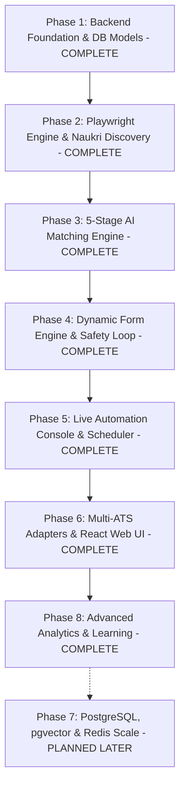

# PHASE.md — Master Phased Implementation Blueprint

## 1. Overview & Strategy

This document outlines the **8-Phase Vertical Slice Implementation Strategy** for the Job Automation Platform. Every phase produces a fully testable, demonstrable capability. No phase is marked complete without meeting the **Definition of Done (DoD)**.

---

## 2. Detailed Phase Specifications

### Phase 1: Backend Foundation, Data Models & AI Gateway
- **Objective**: Establish the Clean Architecture folder structure, database models, AES-256-GCM session cryptography, Pydantic schemas, and pluggable AI Gateway.
- **Milestones**:
  - **1.1**: Clean Architecture scaffolding (`api`, `application`, `domain`, `infrastructure`, `workers`, `core`).
  - **1.2**: Database setup with SQLAlchemy 2.0 ORM, SQLite WAL mode (`PRAGMA journal_mode=WAL;`), and Alembic migrations.
  - **1.3**: Complete domain models (Auth, Profiles, Experiences, Resumes, Jobs, Matches, Applications, AI Requests).
  - **1.4**: Security layer: JWT authentication and AES-256-GCM `storage_state` encryption.
  - **1.5**: Strongly-typed `AIGateway` with `GroqProvider` (fast Llama-3) and `GeminiProvider` (validation fallback) plus token/cost tracking.
  - **1.6**: `LocalTaskQueue` in-process queue abstraction.
- **Acceptance Criteria**:
  - All unit and repository tests pass in SQLite with zero lock errors.
  - AI Gateway successfully routes requests to Groq, records token cost to `ai_requests`, and falls back to Gemini on simulated errors.

---

### Phase 2: Playwright Engine Core & Initial Source Discovery
- **Objective**: Implement the browser automation infrastructure, stealth configurations, `BaseJobSourceAdapter` contract, and the Naukri Job Discovery Adapter with full date freshness parsing.
- **Milestones**:
  - **2.1**: `BrowserManager` and `ContextManager` (session injection, stealth plugins, randomized user delays, screenshot streamers).
  - **2.2**: `BaseJobSourceAdapter` interface and `AdapterRegistry`.
  - **2.3**: `NaukriAdapter` discovery implementation (search query execution, multi-page pagination, job card extraction).
  - **2.4**: Temporal Freshness Normalization pipeline (`PostedDateParser`, `FreshnessCalculator`, bucket classification `1h` through `30d`, dynamic score computation $0\text{--}100$).
  - **2.5**: Job normalization pipeline, temporal distinction (`posted_at`, `first_seen_at`, `last_seen_at`), and database deduplication (`(source_id, external_job_id)` with `touch_seen()` updates).
  - **2.6**: Pre-flight session `health_check()` probe.
- **Acceptance Criteria**:
  - Automated job search extracts 20+ jobs from Naukri, normalizes attributes and freshness metadata into the `jobs` table, and updates `last_seen_at` on existing duplicate records without errors.

---

### Phase 3: 5-Stage Multi-Tier AI Matching Engine
- **Objective**: Build the cost-optimized matching cascade and the Policy/Decision Engine with recency weighting.
- **Milestones**:
  - **3.1**: Stage 1 Hard Filters (Experience, Location, Salary, Remote, and `max_job_age_hours` freshness cutoff at $0$ AI cost).
  - **3.2**: Stage 2 Structured Skill Overlap calculator (Set/Jaccard scoring).
  - **3.3**: Stage 3 Semantic Similarity calculation (Local cosine in Dev).
  - **3.4**: Stage 4 Groq Reasoning provider (detailed breakdown, matched/missing skills, pros/cons).
  - **3.5**: Stage 5 Gemini Validation provider for low-confidence scores or high-CTC roles.
  - **3.6**: Freshness Weight Integration: dynamic decay scoring combined into final multi-attribute ranking formula.
  - **3.7**: `DecisionEngine` assigning `AUTO_APPLY`, `REQUIRE_APPROVAL`, `SAVE`, `SKIP`, or `REJECT`.
- **Acceptance Criteria**:
  - 100 discovered jobs run through the cascade: 70% discarded at Stage 1/2 ($0$ API cost, filtering out aged jobs), top candidates scored with Groq in $< 1.5\text{ s}$, decisions assigned correctly with freshness weighting.

---

### Phase 4: Dynamic Form Automation & Human-in-the-Loop Engine
- **Objective**: Build the heuristic DOM analyzer, semantic intent classifier, form filler, and challenge pause mechanism.
- **Milestones**:
  - **4.1**: Heuristic DOM analyzer (extracting label, placeholder, name, ARIA, and nearby context).
  - **4.2**: Semantic Intent Classifier (mapping fields to `EXPECTED_CTC`, `NOTICE_PERIOD`, `EXPERIENCE`, etc.).
  - **4.3**: Multi-step wizard navigator (Step 1 of $N$ validation and progression).
  - **4.4**: Personal Q&A Knowledge Base resolver + AI screening answer generator.
  - **4.5**: Resume file upload automation.
  - **4.6**: Human-in-the-loop pause handlers (`PAUSED_OTP`, `PAUSED_CAPTCHA`, `PAUSED_USER_INPUT`).
  - **4.7**: Playwright trace (`.zip`) and screenshot retention on failure.
- **Acceptance Criteria**:
  - Form engine successfully maps and fills a multi-step job application form without fragile CSS selectors; halts cleanly on OTP/CAPTCHA challenge and resumes after token signal.

---

### Phase 5: Live Automation Console, WebSockets & Scheduling
- **Objective**: Implement real-time dual-stream broadcasting (visual frames + domain events), manual takeover controls, and background automation scheduling.
- **Milestones**:
  - **5.1**: Dual-stream WebSocket server (`/api/v1/ws`) streaming frame snapshots and timeline events.
  - **5.2**: Live interactive controls (`PAUSE`, `RESUME`, `TAKE_CONTROL`, `STOP`).
  - **5.3**: Background Scheduler Worker for periodic cron and interval execution.
  - **5.4**: Comprehensive Finite State Machine (FSM) validation.
  - **5.5**: Application tracker & immutable audit logger.
- **Acceptance Criteria**:
  - Live console displays real-time visual snapshots alongside the event timeline; user can pause and resume the run via WebSockets without worker crashes.

---

### Phase 6: Extended ATS Adapters & React Web UI
- **Objective**: Add additional job platforms and build the full-featured React + TypeScript web frontend.
- **Milestones**:
  - **6.1**: `LinkedInAdapter` (Search + Easy Apply).
  - **6.2**: ATS Adapters: `GreenhouseAdapter`, `LeverAdapter`, `WorkdayAdapter`, `AshbyAdapter`.
  - **6.3**: React + TypeScript + Vite + Tailwind CSS Web Dashboard:
    - Candidate Profile & Multi-Resume Library.
    - Job Search & Discovery Explorer.
    - AI Job Matches & Nuance Breakdown View.
    - Application Tracker / CRM Kanban board.
    - Live Automation Console with embedded browser frame stream.
    - Automation Rules & Schedules Manager.
- **Acceptance Criteria**:
  - Full end-to-end user journey executed through the React UI across both portal (Naukri/LinkedIn) and direct ATS (Greenhouse/Lever) applications.

---

### Phase 7: Production Infrastructure Migration (Scale & SaaS)
- **Objective**: Seamlessly switch infrastructure implementations to PostgreSQL, `pgvector`, Redis, and Celery worker pools.
- **Milestones**:
  - **7.1**: PostgreSQL 16+ migration with `pgvector` HNSW vector indexes.
  - **7.2**: Redis 7+ and Celery/ARQ distributed task queue.
  - **7.3**: S3-compatible object storage for resumes and failure traces.
  - **7.4**: Containerized headless browser worker pool (Docker / Kubernetes / Xvfb).
- **Acceptance Criteria**:
  - Infrastructure migration completes with zero changes to domain and application layers; system handles 10 concurrent browser sessions smoothly.

---

### Phase 8: Advanced Analytics & Machine Learning
- **Objective**: Implement outcome analytics and automated matching optimization.
- **Milestones**:
  - **8.1**: Funnel analytics (Applications $\to$ Responses $\to$ Interviews by company, role, resume version).
  - **8.2**: Match weight learning suggestions based on interview conversion history.
  - **8.3**: Automated follow-up and reminder trackers.
