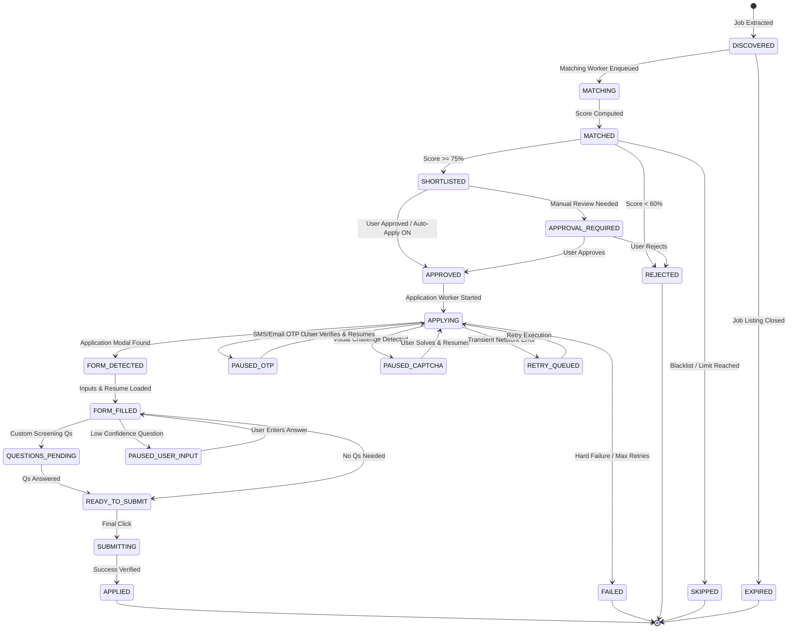

# STATE_MACHINE.md — Application Workflow States & Transitions

## 1. State Machine Overview

The application lifecycle is strictly managed by a **Finite State Machine (FSM)** to ensure deterministic execution, prevent race conditions, and provide clear user visibility.

---

## 2. Complete State Definitions

| State | Category | Description |
|---|---|---|
| `DISCOVERED` | Initial | Job extracted from external source and saved in catalog. |
| `MATCHING` | Active | 5-stage matching cascade currently executing. |
| `MATCHED` | Intermediate | Match score and criteria calculated. |
| `SHORTLISTED` | Intermediate | Job meets minimum score threshold. |
| `APPROVAL_REQUIRED` | Pause/Review | Awaiting explicit candidate approval. |
| `APPROVED` | Ready | Enqueued in task queue for browser application. |
| `APPLYING` | Active | Playwright worker has opened the job portal and started application. |
| `FORM_DETECTED` | Active | Heuristic DOM scanner identified application form fields. |
| `FORM_FILLED` | Active | Contact info, experience, and resume file attached. |
| `QUESTIONS_PENDING` | Active | Screening questions detected and undergoing AI/Saved answer resolution. |
| `READY_TO_SUBMIT` | Active | All validations passed; ready for final submit trigger. |
| `SUBMITTING` | Active | Submit button clicked; awaiting response confirmation. |
| `APPLIED` | **Terminal** | Successful submission verified and logged to audit table. |
| `PAUSED_OTP` | **Pause** | Worker halted due to OTP challenge; waiting for user verification. |
| `PAUSED_CAPTCHA` | **Pause** | Worker halted due to CAPTCHA; waiting for manual solve. |
| `PAUSED_USER_INPUT` | **Pause** | Low-confidence question halted for candidate review. |
| `RETRY_QUEUED` | Recovery | Transient network timeout encountered; scheduled for backoff retry. |
| `FAILED` | **Terminal** | Permanent error after retries or unrecoverable DOM failure. |
| `SKIPPED` | **Terminal** | Skipped due to user blacklist, daily cap, or duplicate application. |
| `REJECTED` | **Terminal** | Rejected due to failing hard filters or candidate manual discard. |
| `EXPIRED` | **Terminal** | Job posting was closed or expired by employer before application. |

---

## 3. Transition Validation Rules

- **Strict Guards**: Direct jumps such as `DISCOVERED` $\to$ `SUBMITTING` or `MATCHING` $\to$ `APPLIED` are forbidden and raise an `InvalidStateTransitionException`.
- **Terminal States**: Once an application reaches `APPLIED`, `FAILED`, `REJECTED`, `SKIPPED`, or `EXPIRED`, no further state transitions are permitted.
- **Idempotency Guard**: State updates to `APPLYING` or `SUBMITTING` verify that no active concurrent worker is processing the same `(user_id, job_id)` pair.
