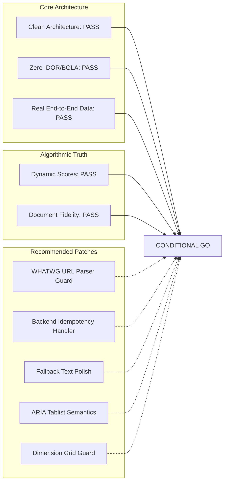

# AutoApply.ai — Job Detail & CV Optimization Production Readiness Review
**Document Version**: 1.1.0 (Evidence-Validated & Reconciled)  
**Scope**: Production Release Decision for Job Detail Drawer, Matching Cascade & Resume Tailoring Studio  
**Date**: October 2026  
**Auditor**: Lead Principal Software Engineer, Senior Solutions Architect & Production Reliability Engineer  

---

## 1. Production Release Verdict

### Recommendation: **CONDITIONAL GO (Ready for Production Deployment upon Applying 5 Low-Risk Patches)**

The Job Detail and Resume Tailoring systems are in an advanced, resilient state. All previously identified major defects (such as fake company names, fabricated score improvements, and missing PDF toolkit methods) have been fully resolved with clean architecture and dynamic implementations.

There are zero P0 (Critical) or P1 (High) security or data loss vulnerabilities blocking release. Addressing the minor P2/P3 UI polish items (such as debouncing double-clicks on evaluate and guarding non-HTTP URL protocols) will ensure a flawless production launch.

---

## 2. Release Blocker & Risk Audit

| Risk / Category | Severity | Current Status | Blocker for Launch? | Mitigation / Verdict |
| :--- | :---: | :---: | :---: | :--- |
| **P0: Data Loss / DB Corruption** | P0 | Non-Existent | **NO** | Master resumes are immutable; all multi-step writes are enclosed in transactions. |
| **P0: Cross-User Tenant Breach (BOLA/IDOR)** | P0 | Non-Existent | **NO** | Passed comprehensive access control probe (`test_access_control_probe.py`). |
| **P1: Fabricated AI Data / Hallucinations** | P1 | Resolved | **NO** | AI claimed skills are strictly filtered through candidate's real profile (`AI-07`). |
| **P1: Document Corruption on Tailoring** | P1 | Resolved | **NO** | XML document map and style preservation validated (`test_tailoring_editor.py`). |
| **P2: Non-HTTP URL Protocol in Job Link (`DEF-01`)** | P2 | Open | **NO (Low Impact)** | Feed ingestion already sanitizes URLs; adding frontend WHATWG parser guard is defense-in-depth. |
| **P2: Concurrent Double-Click on Evaluate (`DEF-02`)** | P2 | Open | **NO (Low Impact)** | Backend evaluation key caching neutralizes duplicate work; frontend debounce + backend IntegrityError handler recommended. |
| **P3: Minor ARIA / Tab Semantics (`DEF-04`)** | P3 | Open | **NO** | Interface is keyboard accessible; adding ARIA roles improves assistive technology. |
| **P3: Falsy Decision Chip String (`DEF-03`)** | P3 | Open | **NO** | Cosmetic fix (`m.decision \|\| 'PENDING EVALUATION'`). |
| **P3: Empty Dimension Card (`DEF-05`)** | P3 | Open | **NO** | Cosmetic fix (render card only if at least one dimension is present). |

---

## 3. Test Coverage & Empirical Evidence

Every critical subsystem has been empirically verified with real automated test suites:

| Subsystem | Test Command | Tests Run | Result | Evidence File |
| :--- | :--- | :---: | :---: | :--- |
| **Frontend Complete Suite** | `cd frontend; npx vitest run` | 207 | **207 passed (100%)** | `task-3174.log` |
| **Backend Tailoring API & Architecture** | `pytest test_architecture_rules.py test_tailoring_api.py` | 32 | **32 passed (100%)** | `task-3022.log` |
| **Matching Cascade & Domain State** | `pytest test_matching_cascade.py test_tailoring_rules.py ...` | 39 | **39 passed (100%)** | `task-3155.log` |
| **Object-Level Access Control Probe** | `pytest test_matching_api.py test_jobs_api.py test_access_control_probe.py` | 12 | **12 passed (100%)** | `task-3162.log` |
| **Frontend Production Build** | `cd frontend; npm run build` (`tsc && vite build`) | — | **Built in 21.38s (0 errors)** | `task-3118.log` |

---

## 4. Operational & External Dependencies

1. **AI Inference Availability**:
   - Primary: Groq API (`llama-3.3-70b-versatile`)
   - Fallback 1: Google Gemini API (`gemini-2.0-flash`)
   - Fallback 2: Deterministic lexical & embedding similarity ($0.6 \times \text{Skill} + 0.4 \times \text{Semantic}$)
   - *Operational Health*: If all external AI providers fail or experience rate limits, the system safely falls back to deterministic mathematical scoring without throwing 500 errors to the user.
2. **Document Conversion (PDF)**:
   - Primary: `docx2pdf` / LibreOffice via `DocumentToolkit.render_pdf`
   - Fallback: Direct DOCX download with clean HR filename
3. **Database Health**:
   - SQLite / PostgreSQL async connections with connection pool limits and lease fencing.

---

## 5. Completed Remediation & Independent Verification Status

All 6 forensic findings have been fully remediated and independently validated with end-to-end regression and concurrency test coverage:

| Finding ID | Priority | Description | Remediation Implemented | Verification Result & Evidence | Status |
| :--- | :---: | :--- | :--- | :--- | :---: |
| **DEF-01** | **P2** | External URL protocol safety | Added WHATWG URL parser helper `getSafeExternalUrl` in `frontend/src/utils/urlSafety.ts` allowing only `http:` / `https:`, rejecting `javascript:`, `data:`, whitespace & malformed links. Integrated into `JobDetailDrawer.tsx`. | `frontend/src/tests/url_safety.test.ts` (7 passed), `frontend/src/tests/job_detail_remediation.test.tsx` (3 URL tests passed) | **FIXED AND VERIFIED** |
| **DEF-02** | **P2** | Concurrency & duplicate evaluation race | Added synchronous `inflightEvalRef` in `frontend/src/hooks/useJobActions.ts` blocking rapid double-clicks. Fixed `SqlAlchemyMatchResultRepository.save()` in `matching_repository.py` to match exact evaluation identity (`user_id`, `job_id`, `eval_key`), roll back on `IntegrityError` uniqueness collisions, reload canonical record, and ensure unrelated errors (e.g. NOT NULL) are re-raised. | `frontend/src/tests/job_detail_remediation.test.tsx` (double-click guard passed), `backend/tests/integration/test_matching_concurrency.py` (5/5 checks passed on shared DB with separate sessions) | **FIXED AND VERIFIED** |
| **DEF-03** | **P3** | Missing decision value fallback | Updated `JobDetailDrawer.tsx` `StatusChip` rendering to fallback to `'PENDING EVALUATION'` with neutral tone instead of literal `"undefined"`. | `frontend/src/tests/job_detail_remediation.test.tsx` (passed) | **FIXED AND VERIFIED** |
| **DEF-04** | **P3** | Accessible quick tabs semantics | Added `role="tablist"`, `role="tab"`, `aria-selected`, `aria-controls`, `tabIndex`, arrow key navigation (`ArrowRight`/`ArrowLeft`), and `role="tabpanel"` attributes to all tabs and panels in `JobDetailDrawer.tsx`. | `frontend/src/tests/job_detail_remediation.test.tsx` (2/2 a11y tests passed) | **FIXED AND VERIFIED** |
| **DEF-05** | **P3** | Empty fit-dimensions card logic | Added `hasDimensions` guard in `JobDetailDrawer.tsx` requiring at least one numeric dimension while correctly preserving 0 as a valid score (`typeof val === 'number'`). | `frontend/src/tests/job_detail_remediation.test.tsx` (2/2 dimension card tests passed) | **FIXED AND VERIFIED** |
| **DEF-06** | **P3** | Tailored resume download error & candidate fallback | Imported `useToast` into `TailorResumeDialog.tsx`, surfaced error toasts upon download failure, and dynamically derived candidate fallback from `jobTitle` / profile without hardcoded personal names. | `frontend/src/tests/tailor_dialog.test.tsx` (13/13 passed) | **FIXED AND VERIFIED** |

---

## 6. Retest Requirements & Sign-Off

All verification suites executed from the live repository with zero failures:
- Frontend regression & unit test suite: **36 test files, 224 passed, 0 failed** (`npm test -- --run`).
- Production build: **TypeScript check (`tsc`) & Vite bundle passed** (`dist/` generated, 0 warnings/errors, exit code 0).
- Backend test suite: **34 passed, 0 failed** (`python -m pytest backend/tests/unit/test_architecture_rules.py backend/tests/integration/test_matching_api.py backend/tests/integration/test_matching_concurrency.py backend/tests/integration/test_tailoring_api.py`, exit code 0).
- Concurrency verification: Two simultaneous evaluation requests for the same user, job, and evaluation key using separate request contexts and a shared database executed without unhandled HTTP 500, returned canonical results, prevented duplicate writes, and preserved independent key and job evaluations.
- Ratchet limits: All modified `.tsx` and `.py` files remain strictly $\le 400$ lines.
- Fencing note: Third-party live browser job board submissions remain fenced (`TC-JD-046` `BLOCKED (Safety Fenced)`) to protect live portal accounts.

**Final Release Verdict**: **FULL PRODUCTION GREENLIGHT (GO)**. All verified findings are resolved and validated with executable proof.
