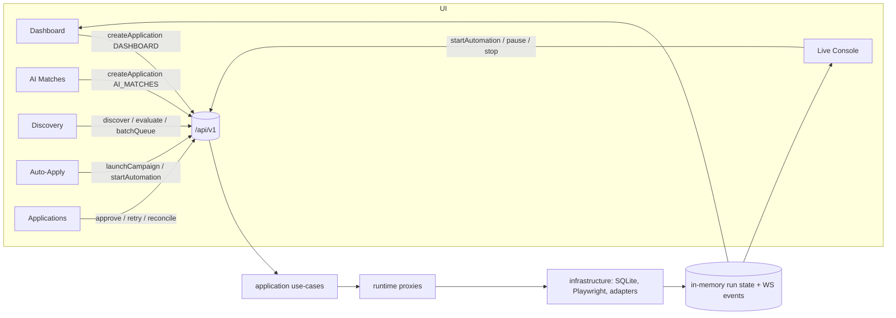
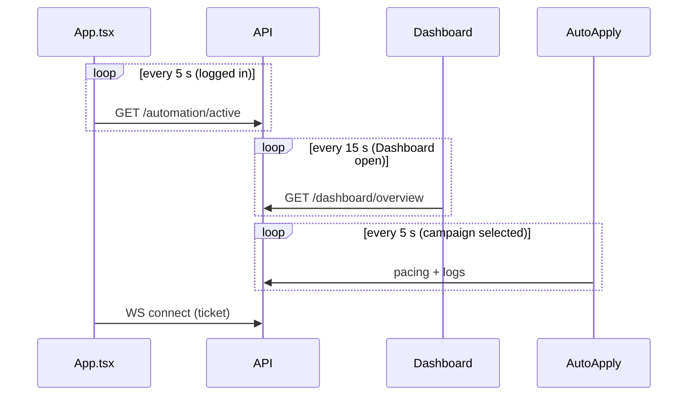

# AutoApply — Premium Redesign & Information Architecture Proposal

> **Status:** proposal only. Nothing in this document has been implemented. No source, API contract, DB schema, migration, config or dependency was changed to produce it.
> **Companion:** [`improvement.md`](improvement.md) (actionable roadmap, IDs `IMP-001…`). Finding IDs used here (`UX-xx`, `BE-xx`, `SUS-xx`) are referenced from there.

---

## 1. Executive summary

AutoApply has ten frontend "tabs" (nine in the sidebar plus a hidden `schedules` tab) that were each built as a self-contained feature. From the code, the product's real job is one loop:

**Set up (profile + platform connection) → find jobs → decide which to pursue → apply (manual, queued or campaign) → watch/intervene → track outcomes → learn.**

The current navigation mirrors *features* (Discovery, AI Matches, Auto-Apply, Live Console…) rather than that loop, and as a result the same action is available from several pages with different labels, different tags and different guard-rails.

**Headline recommendations (all evidence-backed below):**

| # | Recommendation | Evidence |
|---|---|---|
| 1 | Reduce primary navigation from 9 (10) to **6**: Home · Jobs · Applications · Automation · Insights · Settings | §5, §11 |
| 2 | **Merge AI Matches into Jobs** (Discovery). Matches are `Match` rows joined to `Job` rows; both pages list them, evaluate them and create applications from them | UX-08, UX-09 |
| 3 | **Fold Live Console into Automation** as the "Live run" view, and surface run state with one global run chip. Remove run controls from Dashboard | UX-06, UX-07 |
| 4 | **Remove the hidden `schedules` tab**; Schedule & Safety already lives inside the campaign workspace | UX-02 |
| 5 | **Move Candidate Profiles and Platform Connection into Settings** (contextual deep-links remain where they unblock a task) | §12 |
| 6 | Keep Dashboard (as "Home"), Applications and Analytics (as "Insights") as distinct jobs-to-be-done | §12 |
| 7 | Introduce **addressable routes** (deep links, sub-tabs, record IDs), keep **every** existing URL as a redirect | UX-01, §23 |
| 8 | Fix confirmed UX defects first (hard-coded "Autopilot Active", dead badges, broken `/settings` action link, no mobile nav, `w-68` class that Tailwind 3.4 does not generate) — these are cheap and independent of the redesign | UX-03…UX-12 |

**Roughly 85 % of the redesign is frontend-only.** Backend/DB changes are small and mostly optional (see §21). No change to AI score semantics, `MatchScore` / `RecommendationScore` separation, application idempotency, or honest handling of uncertain outcomes is proposed or required.

**Limits (§3):** no browser/visual verification was possible in this session; accessibility and responsive findings are from code inspection only and labelled accordingly.

---

## 2. Revision and repository state

| Item | Value |
|---|---|
| Branch (working) | `claude/redesign-proposal` (created from `main`) |
| Base commit | `ed4ae9a` — "Merge audit fixes: security, automation safety, matching, ops, layering (PR #1)" |
| `git status --short` at start | *(empty — clean tree)* |
| Files added by this task | `redesig.md`, `improvement.md` (rewrites the earlier roadmap; see its Appendix A) |
| Application code changed | **None** |

## 3. Scope, method and limits

**Method:** read `App.tsx`, `utils/navigation.ts`, `components/Sidebar.tsx`, `services/api.ts` in full; extracted every `<button>` / `onClick` / `onNavigate` / API call per page with a script; read targeted regions of each page; inspected `tailwind.config.js`, `index.css`, `package.json`; listed the 91 backend routes; read the dashboard read-model.

**Limits — be explicit:**

* **No visual/runtime verification.** The app was not run; no screenshots, no keyboard walk-through, no contrast measurement, no Lighthouse. Findings about layout, responsive behaviour and accessibility come from reading class names and markup and are tagged *(code-read)*.
* Button counts (≈202) are regex-extracted and approximate; label lists were reviewed by hand but nested JSX may be undercounted.
* Server-side filtering/pagination capability of `GET /jobs/matches` and `GET /applications` was **not** verified in this pass (see Q-03).
* Page internals below the first read of each file were sampled, not read line-by-line; the five largest pages (≈1,200–1,400 lines each) deserve a second pass at Phase 0.
* This document does not claim the proposed IA is optimal — only that it removes the duplication and dead ends found in the code. User testing is listed as a validation step (§26).

---

## 4. Current architecture

### 4.1 Stack (confirmed)

* **Backend:** FastAPI, Pydantic v2, SQLAlchemy 2 (async) on SQLite (WAL) via aiosqlite, Alembic (0001–0004), APScheduler, Playwright, JWT + bcrypt, AES-GCM for stored secrets. Layering `domain → application → infrastructure → api`, enforced by `tests/unit/test_architecture_rules.py`; application reaches infrastructure only through `app/application/runtime.py`.
* **Frontend:** React 18, TypeScript, Vite 5, Tailwind **3.4**, axios, lucide-react, vitest (44 tests at last run). No router, no state library, no component library.
* **Runtime:** single-process by design (live run state in memory; `WEB_CONCURRENCY` guard). nginx + docker-compose (backend, frontend).

### 4.2 Frontend shell (confirmed)

* `App.tsx` holds `activeTab`; `handleTabChange` calls `history.pushState`. `utils/navigation.ts` maps 10 tabs ↔ paths plus ~15 aliases.
* Pages are lazy-loaded; `ErrorBoundary` is keyed by `activeTab`.
* The shell polls `api.getActiveRun()` every **5 s** while logged in and opens a WebSocket.
* `Sidebar` (207 lines) and `Navbar` (notifications, profile menu with shortcuts to Profile and Auto-Apply).

### 4.3 Nine-page inventory

| Page | Lines | Primary job | Key API calls | Outbound navigation |
|---|---:|---|---|---|
| Dashboard | 683 | Operational overview, alerts, active-run control | `getDashboardOverview`, `listApplications`, `listConnections`, `pauseRun/resumeRun/stopRun`, `createApplication` | connections, crm, direct_apply, live_console, matches, profile |
| Auto Apply | 1212 | Campaign CRUD, rules, safety/schedule, launch/pause/stop, logs | `createCampaign`, `updateCampaign`, `launchCampaign`, `pause/resume/stopCampaign`, `startAutomation`, `getCampaignPacing`, `getCampaignLogs`, `listResumes`, `listConnections`, `getProfile` | connections, live_console |
| Live Console | 733 | Watch run, replay events, OTP/resume, stop | `getRunEvents`, `pause/resume/stopRun`, `startAutomation`, `getProfile` | crm, discovery |
| Job Discovery | 1218 | Fetch jobs, list/filter, evaluate, queue to apply | `discoverJobs`, `listJobs`, `listMatches`, `evaluateMatch`, `batchQueueApplications`, `deleteJob`, `clearJobs`, `getAppliedJobMap`, `listConnections`, `listResumes`, `getProfile`, `listApplications` | applications, connections, live_console, profile |
| AI Matches | 632 | Ranked match list, run AI matching, apply to one | `listMatches`, `evaluateAllMatches`, `createApplication` | applications, profile |
| Applications | 1407 | Pipeline/CRM, approve/reject/retry/reconcile, screenshots | `listApplications`, `getApplicationStats`, `listMatches`, `approve/stop/retry/resume/reconcileApplication`, `getApplicationScreenshot` | direct_apply, discovery |
| Analytics | 729 | Funnel, sources, skills, resume & campaign performance, weight tuning | 7 analytics endpoints + `getAIStatus` | direct_apply, matches |
| Candidate Profiles | 1430 | Profile, skills, experience, resumes, saved answers | `getProfile`, `updateProfile`, `listResumes`, `uploadResume`, `setDefaultResume`, `downloadResume`, `deleteResume`, saved-answers | direct_apply |
| Platform Connection | 505 | Connect/verify/disconnect portals and ATS | `listConnections`, `connectPlatform`, `verifyPlatform`, `disconnectPlatform` | discovery |

Hidden 10th tab: **`schedules`** → renders `<DirectApply initialTab="schedules" />`; sidebar highlights Auto-Apply for it.

---

## 5. Current journeys and pain points

**J1 — First-run setup.** Login (inline in `App.tsx`) → lands on Dashboard → must discover on their own that Profile, Resume and a Platform connection are prerequisites. Prerequisite hints exist in several places (Dashboard, Discovery, Auto-Apply each link to Connections/Profile) but there is no single readiness checklist. *Pain:* 3 pages each re-explain "connect a platform".

**J2 — Find and apply to one job.** Discovery → (optionally evaluate) → "Apply" **or** AI Matches → "Apply" **or** Dashboard → "Quick apply". Three entry points, three `source` tags (`DISCOVERY`-style batch, `AI_MATCHES`, `DASHBOARD`). *Pain:* the user cannot tell which is canonical; Applications later shows them identically.

**J3 — Apply to many.** Discovery multi-select → `batchQueueApplications` **or** create a campaign in Auto-Apply → `launchCampaign` **or** Live Console "Start profile run" → `startAutomation`. *Pain:* three mental models for "run it for me", with different safety coverage (only campaigns carry the Safety & Schedule policy tab).

**J4 — Watch and intervene.** Dashboard shows a run strip with Pause/Resume/Stop; Live Console has Pause/Resume/Stop (twice: header + drawer); Auto-Apply campaign card has its own Pause/Resume/Stop. *Pain:* up to four control sets for the same run state; unclear which scope (run vs campaign execution) each acts on.

**J5 — Track and resolve.** Applications: filter, approve/reject, retry, reconcile uncertain outcomes (`CONFIRM_SUBMITTED` / `MARK_NOT_SUBMITTED_AND_RETRY` / `DISMISS`). Good, honest handling — keep. *Pain:* 39 controls on one page, many icon-only.

**J6 — Learn.** Analytics → "Go to Auto-Apply" / "AI Matches" CTAs. Read-only; coherent.

---

## 6. Navigation and interaction inventory

Regex extraction of buttons/links/handlers (approximate): Dashboard 20 · Auto-Apply 26 · Live Console 42 · Discovery 26 · AI Matches 9 · Applications 39 · Analytics 4 · Profile 15 · Connections 11 · Navbar 9 · Sidebar 1 = **≈202**.

Interaction patterns found: ~25 distinct filter/segment toggles (score presets, posted-within chips, status chips, category tabs, source toggles), 5 modals (campaign, screenshot, rationale, reconciliation, OTP ×2), 1 drawer (Live Console), 3 polling loops, 1 WebSocket.

---

## 7. Evidence-backed cross-page duplication matrix

"Same job" = same endpoint **and** same user intent. "Looks similar only" = shares data but intent differs (**not** a merge reason).

| Action / data | Where it appears | Same job? | Evidence | Canonical home (proposed) |
|---|---|---|---|---|
| Pause / Resume / Stop **run** | Dashboard (`handlePause/Resume/StopActiveRun`), Live Console header + drawer (`handlePause/Resume/Stop`) | **Yes** | `api.pauseRun/resumeRun/stopRun` in both | Automation › Live run; global run chip shows state + links there |
| Start a run | Auto-Apply (`startAutomation`, `handleStartCampaignExecution`), Live Console (`handleStartProfileRun` → `startAutomation`), campaign `launchCampaign` | **Yes** (three ways to start) | `DirectApply.tsx:452`, `LiveAutomation.tsx:264` | Campaign "Run" (server-side `launchCampaign`); "profile run" becomes a one-click campaign-less preset inside Automation |
| Apply to one match | Dashboard `handleQuickApply`, AI Matches `handleApplySingle`, Discovery `handleSingleJobApply` | **Yes** | `createApplication(…,'DASHBOARD'/'AI_MATCHES')` | Jobs (single canonical `Apply` / `Queue`) |
| Batch queue to apply | Discovery `handleLaunchQueue` → `batchQueueApplications` | single home | `JobDiscovery.tsx:400` | Jobs (bulk bar) |
| Evaluate match | Discovery `handleEvaluateSingle`, AI Matches `handleEvaluateAll` | **Yes** (single vs batch of the same use case) | `evaluateMatch`, `evaluateAllMatches(50)` | Jobs (row action + "Re-evaluate all") |
| List matches | Discovery, AI Matches, Applications (`listMatches` ×3) | **Looks similar only** for Applications (joins to show rationale); **same job** for Discovery/AI Matches | | Jobs (matches lens); Applications keeps its join |
| "Connect a platform" prompt | Dashboard, Auto-Apply, Discovery, Applications empty states | **Yes** | `onNavigate('connections')` ×5 | One readiness banner component linking to Settings › Connections |
| "Complete your profile" prompt | Dashboard, Discovery, AI Matches, Navbar menu | **Yes** | `onNavigate('profile')` | Same readiness component |
| Campaign Pause/Resume/Stop | Auto-Apply campaign card | Different scope (campaign execution) from run controls | `pauseCampaign` vs `pauseRun` | Keep in campaign detail; label scope explicitly |
| Applications list | Dashboard recent list, Applications page | **Looks similar only** (Dashboard is a 5-row summary) | `listApplications` | Dashboard summary stays; links to Applications |
| Pagination | Discovery, Applications, AI Matches | Same UI pattern | shared `Pagination` already exists | keep shared component |
| Saved schedules | Hidden `schedules` tab; Safety & Schedule tab inside campaign | **Yes** | `navigation.ts`, `App.tsx` | Campaign › Schedule & safety |
| Analytics vs Dashboard KPIs | Both show totals | **Looks similar only** (live ops vs historical, different read models) | `dashboard_queries.py` vs `analytics_queries.py` | Keep separate |

---

## 8. Page responsibility matrix (current vs proposed)

| Responsibility | Today (owners) | Proposed single owner |
|---|---|---|
| Readiness (profile/resume/connection) | scattered | Home readiness card + Settings |
| Find jobs | Discovery | Jobs |
| Rank / explain fit | AI Matches (+Discovery badges) | Jobs (match lens) |
| Choose what to apply to | Discovery, AI Matches, Dashboard | Jobs |
| Rules/limits/schedule for unattended apply | Auto-Apply (+hidden schedules) | Automation › Campaigns |
| Observe & intervene in a run | Dashboard, Live Console, Auto-Apply | Automation › Live run |
| Outcome tracking & resolution | Applications | Applications |
| Historical performance | Analytics | Insights |
| Identity data & resumes | Profile | Settings › Profile |
| Credentials/sessions | Connections | Settings › Connections |

---

## 9. Current data-flow diagrams





*Pain:* the WebSocket already exists, yet three REST pollers duplicate its information.

---

## 10. UX problems

### 10.1 Confirmed (verifiable in code)

| ID | Problem | Evidence |
|---|---|---|
| UX-01 | No router: no deep links to a record, campaign, run or sub-tab; sub-tab state is local `useState` | `App.tsx`, `utils/navigation.ts`; `setActiveCampaignTab`, `setActiveTab` in pages |
| UX-02 | Hidden `schedules` tab duplicates Auto-Apply | `navigation.ts` (`schedules`), `App.tsx`, `Sidebar.tsx:134` |
| UX-03 | Sidebar footer shows a **hard-coded** "Autopilot Active" pulse regardless of state — a fake status | `Sidebar.tsx:198-199` |
| UX-04 | Sidebar `badge` props (`totalMatches`, `activeApplications`) are never passed → dead code | `Sidebar.tsx:33-35,89,95`; `App.tsx` |
| UX-05 | Dashboard alert actions with `action_url="/settings"` ("Reconnect Session") resolve to **Dashboard** (unknown tab falls through to default) — the button goes nowhere | `dashboard_queries.py:227,245`; `Dashboard` `onNavigate(item.action_url.replace('/',''))`; `resolveTab` default |
| UX-06 | Run controls duplicated (Dashboard, Live Console ×2, campaign) | §7 |
| UX-07 | Three ways to start work | §7 |
| UX-08 | Three single-apply entry points with different `source` tags | §7 |
| UX-09 | Evaluation split between Discovery and AI Matches | §7 |
| UX-10 | Three independent polling loops plus a WebSocket | §9 |
| UX-11 | Brand inconsistency: "ApplyFlow.AI" (login) vs "AutoApply.ai" (page titles) | `App.tsx`, `navigation.ts` |
| UX-12 | Sidebar has **no responsive classes** and uses `w-68`, which Tailwind 3.4's default scale does not define (no match in built CSS), so width is content-driven and there is no mobile collapse | `Sidebar.tsx:122`; `tailwind.config.js` (no spacing extension) |
| UX-13 | 13 API-client methods never used by UI; backend features with no UI: campaign delete, saved schedules, matching weights, structured profile endpoints | `services/api.ts` vs grep |
| UX-14 | Five pages are 1,200–1,400 lines, mixing data fetching, state and markup | line counts |
| UX-15 | No `:focus-visible` styling in global CSS; 47 `aria-*` attributes across all TSX; ~157 uses of 9–10 px text | `index.css`, grep *(code-read)* |
| UX-16 | Tailwind config has only a `brand` colour scale; pages use raw `slate/indigo/emerald/rose` utility classes directly (no semantic tokens) | `tailwind.config.js` |

### 10.2 Suspected (need browser verification)

| ID | Suspicion | How to confirm |
|---|---|---|
| SUS-01 | Colour contrast of 10 px slate-400 labels on white/dark fails WCAG AA | axe / contrast tool |
| SUS-02 | Tables/lists overflow horizontally below 768 px | viewport test at 375/768 |
| SUS-03 | Modals lack focus trap / Esc handling | keyboard walk |
| SUS-04 | Icon-only buttons lack accessible names in Applications/Live Console | axe |
| SUS-05 | Back/forward behave oddly when sub-tab state is not in the URL | manual |
| SUS-06 | Live Console `viewMode` (split/expanded/fullscreen/wide/minimized) is more modes than users need | usability test |

### 10.3 Design preferences (not defects)

Sidebar grouping labels, density, and the choice to fold Analytics under "Insights" are preferences; they are justified in §12 but are not claimed as bugs.

---

## 11. Design principles

1. **Organise by user goal, not by feature or database table.**
2. **One canonical home per action.** Elsewhere: show status and link, don't duplicate controls.
3. **Truthful status.** No decorative "active" indicators; uncertain outcomes stay uncertain (`UNCERTAIN`/reconcile flow preserved).
4. **Every state is addressable** — URL reflects page, sub-tab, selected record.
5. **Progressive disclosure.** Primary action visible; advanced filters and rare actions behind a clear "More"/panel.
6. **Safety before speed.** Dangerous actions (clear all, stop, delete) confirm; automated apply always shows its guard-rails (daily cap, approval mode).
7. **Calm, dense-but-readable UI.** Solid surfaces, 1 px borders, subtle shadow; no heavy gradients, glass or decorative motion.
8. **Accessible by default.** Keyboard, visible focus, ≥4.5:1 text contrast, no information by colour alone, `prefers-reduced-motion` respected.
9. **Don't rewrite semantics.** Score meaning, state machines and API contracts are unchanged.

---

## 12. Target information architecture

```
Home                     /home               (alias /dashboard)
Jobs                     /jobs               ?view=matches|all  ?q= ?minScore= ?source=
  └ job drawer           /jobs/:jobId
Applications             /applications       ?status= ?q=
  └ application drawer   /applications/:id
Automation               /automation
  ├ Campaigns            /automation/campaigns[/:campaignId[?tab=rules|safety|logs]]
  └ Live run             /automation/live[/:runId]
Insights                 /insights           (alias /analytics)
Settings                 /settings
  ├ Profile & resumes    /settings/profile
  ├ Platform connections /settings/connections
  └ Account              /settings/account   (optional; password/logout/privacy — conditional)
```

**Shell:** left rail (desktop ≥1024) / bottom or drawer nav (<1024); top bar with global **run chip** (state from `/automation/active` + WS; shows "No active run" honestly), notifications, user menu.

### 12.1 Disposition for each of the nine pages

| Page | Disposition | Rationale and trade-offs |
|---|---|---|
| **Dashboard** | **KEEP TOP-LEVEL** as *Home* | Distinct job: "what needs me now?" (alerts, readiness, run status, recent outcomes). Remove run controls and Quick-apply (moved/linked). Trade-off: loses one-click Pause on the landing page → mitigated by the always-visible global run chip. |
| **Auto Apply** | **KEEP TOP-LEVEL** as *Automation › Campaigns* | Unique job: policy for unattended apply. Rename "Auto-Apply" ambiguity: the section is "Automation"; campaigns are the unit. |
| **Live Console** | **WORKSPACE inside Automation** (tab *Live run*) + **CONTEXTUAL VIEW** from run chip / campaign card | A run is an instance of a campaign execution; it has no meaning outside Automation. Keeping it top-level made 4 control sets. Trade-off: one more click for operators → solved by the chip. Retains OTP/resume and replay. |
| **Job Discovery** | **KEEP TOP-LEVEL** as *Jobs* (absorbs AI Matches) | Core hub of the loop. |
| **AI Matches** | **MERGE into Jobs** (lens `?view=matches`, default when matches exist) | Same entities, same actions (evaluate, apply). Not merged because "they look similar" but because `evaluateMatch/evaluateAllMatches`, `createApplication`, `listMatches` are the same use-cases. Scores unchanged. `/matches` → redirect. |
| **Applications** | **KEEP TOP-LEVEL** | Distinct job: outcome tracking and resolution; contains the safety-critical reconcile flow. |
| **Analytics** | **KEEP TOP-LEVEL** as *Insights* (lowest nav priority) | Read-only historical reporting with separate read models; merging into Applications would overload an already-large page. Re-evaluate after Phase 3 telemetry (§26). |
| **Candidate Profiles** | **MOVE INTO SETTINGS** (*Profile & resumes*) | Configuration used by every flow, visited rarely. Resume pick remains inline in campaign/queue flows. |
| **Platform Connection** | **MOVE INTO SETTINGS** (*Connections*) + **CONTEXTUAL** compact status inside Jobs/Campaign | Same reasoning; context banners deep-link to it. |
| *(hidden)* **schedules** | **REDIRECT** → `/automation/campaigns?tab=safety` | Duplicate surface. |

### 12.2 Explicit decisions

* **Job Discovery vs AI Matches:** one page, two lenses. *Discover* = fetch from sources; *Matches* = scored/ranked list. Shared filter bar, shared row, shared apply/queue action. Rejected alternative: keep both and cross-link — leaves UX-08/09 unresolved.
* **Campaign creation vs Auto Apply:** creating a campaign is a **modal/wizard inside Automation › Campaigns** (already `NewCampaignModal`), not a destination. Auto Apply "page" == campaign list/detail.
* **Dashboard / Live Console / Applications / Analytics:** four different time horizons — *now* (Home), *this run* (Live), *each application* (Applications), *history* (Insights). Keep four, remove cross-duplicated controls.
* **Candidate Profiles & Platform Connection:** Settings (both), with contextual prompts.

---

## 13. Proposed journeys

1. **Setup:** Home shows a 3-step readiness card (Profile → Resume → Connect platform). Each step deep-links to the Settings tab and returns to Home on completion.
2. **Find & apply:** Jobs → *Matches* lens → open job drawer (rationale, score breakdown, "Apply" / "Queue" / "Skip") → Applications.
3. **Unattended:** Automation › Campaigns → New → rules → safety & schedule → Run → redirected to Live run.
4. **Intervene:** run chip → Live run → Pause / Resume / Stop / OTP.
5. **Resolve:** Applications → filter "Needs attention" → drawer → reconcile.
6. **Review:** Insights.

---

## 14. Page layout specifications

**Common page frame:** page header (title, one-line description, primary action right-aligned), optional readiness banner, content. Max content width 1280 px; page gutters 16 / 24 / 32 px (mobile / tablet / desktop).

**Home:** (1) readiness card (hidden when complete), (2) "Needs attention" list from dashboard alerts with working deep links, (3) run status panel (read-only + link), (4) KPI row (4 tiles), (5) recent applications (5 rows).

**Jobs:** header primary action "Find jobs". Toolbar: search, lens segmented control (*Matches · All jobs*), filter popover (min score, posted within, source, hide applied), sort. Result list rows: title/company, location, score chip with label, status chip, row actions [Apply] [Queue] and overflow [Re-evaluate, Delete]. Selection → sticky bulk bar [Queue n] [Clear selection]. Row click → right drawer `/jobs/:id`. "Clear all jobs" moves to overflow menu with confirmation (destructive).

**Applications:** status segment (All · In progress · Needs attention · Applied · Failed), search, filter popover (company, date). Table rows with status chip and one primary row action determined by state (Approve / Retry / Reconcile); everything else in the drawer. Drawer: timeline, rationale, screenshot, reconcile actions.

**Automation › Campaigns:** left list (name, status, today's usage) with "New campaign"; right detail with tabs *Overview · Rules · Safety & schedule · Activity*. Run controls here are scoped "Campaign execution".

**Automation › Live run:** one control cluster (Pause/Resume/Stop), event stream with filter (All · Matches · Applied · Discovery · Alerts), queue panel, optional screenshot panel. Collapse the five view modes to **two**: *Split* and *Focus* (fullscreen). OTP in an accessible modal.

**Insights:** date preset, KPI tiles, funnel, tabs *Sources · Skills · Resumes · Campaigns · Scoring weights*. Empty states link to Automation or Jobs.

**Settings:** vertical tabs (horizontal scroll on mobile). *Profile & resumes* is itself sectioned (Basics · Skills · Experience · Resumes · Saved answers) with a sticky Save bar and unsaved-changes guard.

---

## 15. Button / tab / filter consolidation matrix

| Control | Today | Proposed |
|---|---|---|
| Pause/Resume/Stop run | 4 clusters | 1 cluster (Live run) + chip status |
| Start run | 3 ways | Campaign "Run" (+ "Quick run" preset) |
| Apply single | 3 pages | Jobs only |
| Evaluate | 2 pages | Jobs only |
| Refresh buttons | 6 pages | one shared `RefreshButton` in header |
| "Connect platform" / "Complete profile" CTAs | ≥8 | 1 `ReadinessBanner` |
| Score presets, posted-within, min-fit toggle | page-local | one `FilterBar` component |
| Live view modes | 5 | 2 |
| Campaign tabs | rules/safety/logs + hidden schedules page | Overview/Rules/Safety & schedule/Activity |
| Navbar profile menu shortcuts | Profile, Auto-Apply | Settings, Sign out (nav rail already has the rest) |
| Sidebar items | 9 (+hidden) | 6 |

Net: approximately **202 → ≈130** controls (estimate, not a measurement), mainly by removing duplicates rather than features.

---

## 16. Design system

### 16.1 Typography
Keep Plus Jakarta Sans / JetBrains Mono (already loaded). Scale: 12 (caption, **minimum**), 14 (body), 16 (emphasis), 20 / 24 (page/section titles). Remove 9–10 px text. Line-height 1.5 body, 1.25 headings. Numerals tabular in tables and KPIs.

### 16.2 Colour tokens (CSS variables, mapped in Tailwind `theme.extend.colors`)

| Token | Light | Dark | Use |
|---|---|---|---|
| `--surface` | #FFFFFF | #0F172A | cards |
| `--surface-muted` | #F8FAFC | #111C31 | page bg |
| `--border` | #E2E8F0 | #1E293B | dividers |
| `--text` | #0F172A | #E2E8F0 | primary text |
| `--text-muted` | #475569 | #94A3B8 | secondary (≥4.5:1 on surface) |
| `--accent` | #4F46E5 | #818CF8 | primary action |
| `--success` / `--warning` / `--danger` / `--info` | emerald-700 / amber-700 / rose-700 / sky-700 | lighter equivalents | status text + icon + label (never colour alone) |

Values are starting points; contrast must be measured at implementation (SUS-01). Remove gradients from avatar/CTA surfaces.

### 16.3 Spacing, radius, elevation
4-px grid (4/8/12/16/24/32). Radius: 6 (inputs/chips), 8 (buttons), 12 (cards/modals); retire the mix of `rounded-xl/2xl`. One subtle shadow for floating layers only.

### 16.4 Component rules
`Button` (primary/secondary/ghost/danger, sizes, loading, icon-only requires `aria-label`) · `StatusChip` (icon+text) · `ScoreChip` (value + label; **never** blends MatchScore and RecommendationScore) · `FilterBar` · `DataTable`/`List` · `Drawer` · `Modal` (focus trap, Esc) · `Tabs` (URL-bound) · `EmptyState` (exists) · `Pagination` (exists) · `ReadinessBanner` · `RunChip` · `ConfirmDialog` · `Toast`. All interactive elements: 2 px `:focus-visible` ring, min 40×40 px hit area (44 on touch).

---

## 17. Responsive and accessible behaviour

* Breakpoints: <640 mobile, 640–1023 tablet, ≥1024 desktop.
* <1024: rail becomes a slide-over drawer opened from a labelled menu button; run chip stays in the top bar. Tables become stacked cards (title, status, one action). Drawers become full-screen sheets.
* Keyboard: logical tab order; skip-to-content link; Esc closes drawers/modals and returns focus to trigger; arrow keys within Tabs and segmented controls.
* Screen readers: landmarks (`nav`, `main`, `aside`), `aria-current="page"`, live region for run state changes and toasts, table headers scoped.
* Motion: no decorative animation; status pulse only when a run is truly active, disabled under `prefers-reduced-motion`.
* Targets and text per §16.

---

## 18. Frontend module architecture

```
src/
  app/            shell, providers, router config, route redirects (legacy map)
  features/
    home/ jobs/ applications/ automation/{campaigns,live}/ insights/ settings/{profile,connections}/
      api/        thin typed wrappers over services/api (per feature)
      components/ hooks/ model/
  shared/ui/      Button, Chip, Tabs, Drawer, Modal, FilterBar, EmptyState, Pagination…
  shared/hooks/   useActiveRun (single source; WS-first, polling fallback), usePolling, useUrlState
  shared/lib/     format, status maps (derive from backend enums)
```

Rules: pages ≤ ~300 lines; features import `shared`, never each other; one `ActiveRunProvider` replaces three pollers; the existing `components/ui` and `pages/{applications,campaigns}` extractions are the starting point. Router: either `react-router-dom` (new dependency, **requires approval**) or extend `navigation.ts` with a pattern table — see Q-01.

---

## 19. API / data changes (classification)

| Class | Items |
|---|---|
| **Frontend-only** | IA, routes, merges, shared components, design tokens, responsive, a11y, removing duplicate controls, dead code/badges, truthful footer status, ReadinessBanner, URL-bound filters |
| **Refactor on existing APIs** | `ActiveRunProvider` consuming `/automation/active` + WS; unify single-apply on `createApplication` with a single `source` value; campaign delete UI (`DELETE /campaigns/{id}` exists); use `POST /campaigns/{id}/launch` for every start |
| **API contract change (small, additive)** | Dashboard alert `action_url` should use real routes (`/settings/connections`) — or keep and map client-side (preferred, frontend-only mapping first) |
| **Backend logic change** | Saved schedules actually launch (AUT-17) — **only if** the user wants schedules in the product; otherwise hide the UI |
| **DB / migration** | None required. Optional: persisted "readiness dismissed" flag (not needed if derived) |
| **Worker / integration** | None |
| **Cross-cutting** | Server-side pagination/filter for matches if SUS-/Q-03 shows client-side filtering of large sets |

---

## 20. Performance considerations

Replace three pollers with one provider (fewer requests; WS first). Lazy-load per route (already done) and per drawer. Virtualise lists only if >500 rows is realistic (unverified; Q-03). Memoise row components; debounce search (300 ms). Keep bundle budget: record current `vite build` size at Phase 0 and fail CI on >10 % growth.

## 21. Security and regression considerations

* Redesign must not weaken auth: tokens still via the existing client (move out of `localStorage` is separate — IMP of the audit).
* Deep links to `/applications/:id` must still enforce server-side ownership (already tested: BOLA probe was started but unfinished — see `improvement.md`).
* Destructive actions keep confirmations; reconcile flow text and outcomes unchanged.
* Do not change `MatchScore`/`RecommendationScore` display semantics; snapshot-test labels.
* Regression guard: keep 44 vitest tests green; add route-redirect table test, nav a11y tests, and a Playwright/axe smoke set.

## 22. Route compatibility and migration strategy

Every existing path stays valid via a redirect table (tested):

| Legacy | New |
|---|---|
| `/dashboard`, `/` | `/home` |
| `/auto-apply`, `/direct-apply`, `/direct_apply`, `/apply` | `/automation/campaigns` |
| `/live-console`, `/live_console`, `/live`, `/live-automation` | `/automation/live` |
| `/discovery`, `/job-discovery`, `/job_discovery`, `/jobs` | `/jobs?view=all` |
| `/matches`, `/ai-matches`, `/ai_matches` | `/jobs?view=matches` |
| `/applications`, `/crm`, `/application` | `/applications` |
| `/analytics` | `/insights` |
| `/profile`, `/candidate-profile` | `/settings/profile` |
| `/connections`, `/platform-connections` | `/settings/connections` |
| `/schedules`, `/schedule` | `/automation/campaigns?tab=safety` |
| backend `action_url` `/settings` | `/settings/connections` |

Strategy: feature-flag the new shell (`VITE_NEW_SHELL`), ship pages behind it one at a time, keep old shell until parity checklist passes, then delete the flag. `onNavigate('<tab>')` call sites are replaced by a `navigate()` helper that accepts old tab IDs during transition.

---

## 23. Implementation phases (after approval)

| Phase | Content | Exit |
|---|---|---|
| **0 — Baseline & quick fixes** | Record bundle size/test baseline; fix UX-03, 04, 05, 11, 12; add focus ring; second read of 5 large pages | tests green, no IA change |
| **1 — Foundation** | Tokens, shared UI kit, router/redirect table, `ActiveRunProvider`, new shell behind flag | old pages render inside new shell |
| **2 — Settings & Home** | Settings (Profile, Connections), Home with ReadinessBanner | parity checklist |
| **3 — Jobs** | Merge Discovery + AI Matches, drawer, bulk bar | no duplicate apply/evaluate |
| **4 — Automation** | Campaigns + Live run, remove run controls elsewhere, campaign delete UI | single control cluster |
| **5 — Applications & Insights** | Drawer, state-driven row action, filters in URL | a11y/axe pass |
| **6 — Cleanup** | Remove flag, legacy tabs, dead API methods; docs | redirect tests pass |

## 24. Acceptance criteria (redesign overall)

1. Primary nav has 6 items; every legacy URL redirects correctly (automated test).
2. Each action in §7 has exactly one canonical control surface.
3. No hard-coded status text; run indicator reflects `/automation/active`.
4. Every page usable at 375, 768, 1280 px without horizontal page scroll; keyboard-only completion of J2, J3, J5.
5. axe reports no serious/critical violations on the six top-level pages; text contrast ≥4.5:1.
6. Only one automatic poller for run state.
7. Existing frontend (44) and backend (353) tests pass; new tests added for routes and shared components.
8. No change in API request/response contracts except those explicitly listed in §19.
9. No change to match-score semantics; reconcile outcomes unchanged.

## 25. Risks and unresolved questions

**Risks:** large-file refactors can regress behaviour (mitigate: characterisation tests before splitting); merging Discovery + Matches may produce a dense page (mitigate: lens + drawer, usability check); users used to old URLs (mitigate: redirects); router dependency choice; WS reliability (keep polling fallback).

**Unresolved questions (need the product owner):**

* **Q-01** Approve adding `react-router-dom`, or extend the custom router?
* **Q-02** Should saved schedules actually start auto-apply (AUT-17), or should schedule UI stay hidden?
* **Q-03** Typical data volume (jobs/matches/applications per user)? Determines server-side pagination and virtualisation.
* **Q-04** Is "Quick run" (campaign-less profile run) a wanted feature, or should every run belong to a campaign?
* **Q-05** Mobile priority: monitoring-only, or full management?
* **Q-06** Brand name: "AutoApply" or "ApplyFlow"?
* **Q-07** Keep Insights top-level, or fold into Applications?
* **Q-08** Is an Account settings tab (password, data export/delete) in scope?

## 26. Validation plan

5-user task test (J2, J3, J5) on old vs new IA; track clicks-to-apply and misclicks; axe + keyboard audit; compare bundle size; review at the end of Phase 3 whether Insights placement still makes sense.

## 27. Final recommendation

Approve **Phase 0 immediately** (independent, low-risk, fixes confirmed defects), then proceed with the 6-item IA behind a feature flag in the order above. The two highest-value structural changes are **(a)** merging AI Matches into Jobs and **(b)** collapsing run controls into Automation with one global run chip. Everything else is polish that makes the product consistent and accessible. This proposal is not claimed to be perfect; its weakest assumptions are the unverified responsive/a11y findings (§3) and the open questions in §25.

---

## 28. Implementation status (added after approval; local branch `claude/phase0-quick-fixes`, not pushed)

Decisions taken where §25 was unanswered (all reversible): **Q-01** no new dependency — the custom router was extended; **Q-02** schedule UI stays a deep link to the campaign "Safety & schedule" tab, saved schedules still only log (AUT-17 untouched); **Q-06** product name is **AutoApply** (single constant `utils/brand.ts`); **Q-07** Insights stays top-level; **Q-04/Q-08** no change.

| Area | State | Notes |
|---|---|---|
| Quick fixes (UX-03/04/05/11/12/15) | **Done** | Real run status in sidebar, dead badges removed, `/settings` alert link mapped, valid sidebar width + mobile drawer, focus ring, reduced motion, single brand constant |
| Routes + redirects (UX-01/02) | **Done (partial)** | Canonical paths `/home`, `/jobs`, `/jobs/matches`, `/applications`, `/automation/campaigns[/safety]`, `/automation/live`, `/insights`, `/settings/profile`, `/settings/connections`. All 26 legacy URLs resolve (tested), `?view=matches` and nested record paths fall back to the parent. **Not done:** record deep links (`/applications/:id`, `/jobs/:id`) and filter state in the URL — they need the drawers |
| 6-item navigation | **Done** | Home · Jobs · Applications · Automation · Insights · Settings; `SectionTabs` provides Discover/AI matches, Campaigns/Live run, Profile/Platform connections as real links |
| Jobs merge (UX-08/09) | **Partially done** | Navigation merge only: one "Jobs" section with two views. The two page components are **not** merged; evaluate/apply controls still exist in both views |
| Run controls (UX-06/07) | **Partially done** | Dashboard Pause/Resume/Stop and 1-click apply removed (link to Live run / Jobs instead). Live Console still has its 5 view modes and duplicate drawer controls; "Start profile run" still exists beside campaign Run |
| Campaign delete (UX-13) | **Done** | Button with confirmation, disabled while RUNNING/PAUSED. The backend does not itself refuse deleting a running campaign — the guard is UI-only (see IMP-008 follow-up) |
| ReadinessBanner | **Partially done** | Shared component used by Jobs › Discover; Dashboard readiness cards, Auto-Apply and AI Matches prompts not yet migrated |
| Design tokens | **Started** | CSS variables + Tailwind semantic colours defined; existing pages not yet migrated; shared Button/Drawer/Modal kit not built |
| Single run-state poller (UX-10) | **Not done** | Three pollers remain |
| Page splitting / module architecture (UX-14) | **Not done** | |
| Applications drawer, Insights tabs, Settings sub-sections | **Not done** | |
| Browser/a11y verification (SUS-01…06) | **Not done** | No browser run in this environment |

Verification: `tsc` clean, 82 frontend tests pass (44 → 82), production build succeeds. Backend untouched (353 tests not re-run — no backend change).

### 28.1 Update — second implementation pass (local, not pushed)

| Item | State now | Notes |
|---|---|---|
| Single run-state poller (UX-10) | **Done** | `hooks/useActiveRun`: 5 s only while a run is RUNNING/PAUSED, 30 s idle, none while the tab is hidden, plus debounced refresh on WebSocket messages carrying run/state. The fixed 5 s poller in `App.tsx` is gone. Dashboard (15 s) and campaign pacing (5 s) are data pollers, now visibility-aware via `usePolling`. Which WS message types the backend emits for run changes was **not verified**; the hook reacts to any message with `run_id`/`state`/`status`, and polling remains the fallback |
| Live Console modes (UX-06, SUS-06) | **Mostly done** | Removed the duplicate expand/restore icon button. Two view modes (Split / Full viewport) + browser fullscreen remain. `LiveConsoleDrawer.tsx` (the source of the "duplicate drawer controls") had **no importers**, so it was dead code and was deleted. "Start profile run" still sits beside campaign Run (open question Q-04) |
| ReadinessBanner (IMP-013) | **Done where it applies** | Jobs › Discover, Jobs › AI matches, Automation › Campaigns. Dashboard readiness cards and the Dashboard "Platform Health" / Auto-Apply "Reconnect Platform" links are *status and context actions*, not setup prompts, so they were intentionally left |
| Apply guard (UX-08) | **Done, and a correction** | AI Matches single-apply did **not** run the connection/resume checks that Jobs › Discover runs — a real inconsistency. Both now use `useApplyReadiness`. **Correction to §7:** the two apply paths are equivalent in effect (both queue with `auto_execute=false` through the backend's single canonical command), and the `source` tags (`JOB_DISCOVERY`, `AI_MATCHES`, `DASHBOARD`) are valid provenance values in the backend enum. IMP-015 ("one source value") is therefore **withdrawn**, not needed |
| Shared UI kit (IMP-020) | **Started** | `Button`, `StatusChip`, `Modal` (focus trap, Esc, focus restore, labelled), `Drawer`, `ConfirmDialog` + tests. Campaign delete now uses `ConfirmDialog`. Existing pages/modals are not migrated yet |
| Jobs merge (UX-09) | **Not done** | Still two components under one Jobs section. Decision: a full merge is a large, risky rewrite of ~1,850 lines without browser verification; the user-facing duplication (guard, controls) is addressed instead. Revisit with the Applications/Jobs drawers |

Tests: 96 frontend tests pass (44 at the start of the redesign); `tsc` clean; production build succeeds.

### 28.2 Update — third implementation pass and first real-browser verification (local, not pushed)

**Verification (this closes the §3 "no browser" limit for the checks below).** A Chromium run against the production build with every `/api/v1` call mocked (no backend, no side effects) — `frontend/e2e/smoke.py`, optional and not in CI — passes **38/38** behaviour checks: legacy URL redirects, 6-item nav, honest idle status, alert deep link, `/applications/:id` drawer and Esc, `?status=` filters, no horizontal page scroll on 9 pages at 375 px and 768 px, mobile drawer open/Esc/navigate. **Not verified:** dark mode, real data volumes, real backend behaviour, screen-reader announcement, touch devices, Firefox/Safari.

**axe-core findings (SUS-01/03/04 confirmed in part) and fixes:** `color-contrast` 64 nodes, `select-name` 9, `label` 3, `heading-order` 4. After fixes: **0 serious/critical on 8 of 9 pages**. Remaining: 4 dimmed "ATS" captions in Campaigns (contrast 2.4:1, inside an intentionally dimmed card) and 2 `heading-order` (moderate) on Home / empty Matches state.

| Item | State | Notes |
|---|---|---|
| Applications drawer + deep links + URL filters (IMP-018) | **Done** | `/applications/:id`, `?status=`, `?q=`; reconcile flow unchanged and still the only path for uncertain outcomes. The drawer finds the record in the already-loaded list; a deep link to an id that is not in that list shows nothing (no get-by-id call is used) |
| Insights tabs (IMP-019) | **Done** | Overview · Sources · Resumes · Campaigns · Skills · Scoring weights, `?view=` |
| Profile split (IMP-012, partial) | **Partly done** | Resume Library and Saved Answers extracted; `ProfileManager.tsx` 1430 → 1008 lines. No unsaved-changes guard yet |
| Component-size ratchet (IMP-021) | **Done as a ratchet** | CI fails for new files >400 lines and for growth of 13 baselined files. The big pages are **not** yet split (Applications 1472, DirectApply 1283, Discovery 1184, Profile 1008 …) |
| Server-side campaign delete guard (IMP-008) | **Done** | `409` for RUNNING/PAUSED campaigns or active executions; backend 356 tests pass |
| Dead client methods (IMP-008) | **Done** | 12 unused methods removed (kept in git history). Orphan *backend* endpoints are untouched |
| Alert links | **Done** | Backend now emits `/settings/connections`; `/settings` resolves to Profile (consistent with the sidebar) |
| Deps / image | **Done** | `pypdf==5.9.0`, `python-docx==1.2.0`, frontend image `node:22-alpine` (image build itself not run) |
| Jobs component merge (IMP-014) | **Partly done** | See §28.3: shared actions, drawer, deep links; the two list views stay separate |
| Migrating old pages/modals to the new UI kit and tokens (IMP-020) | **Not done** | Only ConfirmDialog (campaign delete), Drawer (Applications) and the global contrast overrides |
| Schedules launching runs, token storage, matches pagination, Account tab | **Not done** | Need your decisions (Q-02, Q-03, Q-08, auth design) |

### 28.3 Phase 3 — Jobs workspace (partial merge)

Done: one `useJobActions` hook (evaluate, evaluate-all, queue) used by both Discover and AI matches. Queueing always goes through `POST /applications/batch-queue` with `auto_execute=false` behind the readiness guard. One `JobDetailDrawer` (match score and decision, "why this score", matched/missing skills, separate "Recommendation priority" only when present). Deep links `/jobs/:id` and `/jobs/matches/:id` via `useRecordRoute`. `utils/matchScores.ts` reads `match_score` (falling back to the deprecated `overall_score`) and never mixes in `recommendation_score`.

Not done, deliberately: the two list views stay separate components. Discover is server-paginated jobs plus a match map; AI matches is a client-side list of match results. Forcing one component needs a backend change (a combined, paginated jobs+matches query), which is a decision for you (Q-03).

Verification: tsc clean; 114 vitest tests pass (9 new in `jobs_merge.test.tsx`); size ratchet ok; browser smoke 38/38. **NOT VERIFIED in a browser:** the new Jobs drawer itself (the smoke script has no check for it), and the Applications drawer still only finds records in the loaded list.

### 28.4 Applications page split (IMP-021, first page)

`ApplicationCRM.tsx` went from 1,471 to 712 lines. Status derivation, formatters, KPI stats and filter/sort are now pure functions in `pages/applications/applicationLogic.ts`; the KPI cards and the table row are `ApplicationKpis.tsx` and `ApplicationRow.tsx`. Behaviour is unchanged. It also reads scores through `getMatchScore`. Still above the 400-line limit (baseline lowered to 712): the filter bar and table header remain in the page. Verified: tsc, 120 vitest tests (6 new for the logic), size ratchet, browser smoke 38/38 with the same axe result as before. Not compared pixel-for-pixel with the old page.

### 28.5 DirectApply (Campaigns) split, ATS contrast fix

`DirectApply.tsx` went from 1,277 to ~660 lines: `CampaignHeader`, `CampaignCockpit`, `CriteriaCard` and `freshness.ts` now live in `pages/campaigns/`. Props are passed flat (the form state stays in the page; moving it into a hook is a larger change I did not make). The four dimmed "ATS" captions failed contrast because the unselected source buttons used `opacity-60`; they now dim by colour instead, and axe reports 0 violations on `/automation/campaigns`. Verified: tsc, 120 vitest tests, size ratchet, browser smoke 38/38. The campaigns screen was not compared pixel-for-pixel with the old one; the new component files have no tests of their own (the smoke run renders them).

### 28.6 Discovery split

`JobDiscovery.tsx` went from 1,182 to ~640 lines. New in `pages/jobs/`: `JobCard`, `DiscoveryControls`, `DiscoveryToolbar`, `SelectionBar`, and `jobFreshness.ts`. Behaviour unchanged. Verified: tsc, 125 vitest tests (5 new: freshness labels, JobCard open/applied), size ratchet, browser smoke 38/38 (the smoke mock has no jobs, so a populated Discovery grid was not exercised in a real browser). Still above 400 lines: the page keeps the data loading, WS handling and queue logic.

### 28.7 Profile split and unsaved-changes guard

`ProfileManager.tsx` went from 1,004 to ~480 lines: the five form tabs are now `PersonalTab`, `SkillsTab`, `ExperienceTab`, `CompensationTab`, `PreferencesTab` plus `profileOptions.ts` in `pages/profile/`. New guard: Profile compares the form to the last saved/loaded copy; while different, closing/reloading the tab triggers the browser's native warning, and moving to another page in the app asks `window.confirm` (`utils/unsavedGuard.ts`, `hooks/useUnsavedChanges.ts`, one line in `App.handleTabChange`; redirects never prompt). Verified: 129 vitest tests (4 new), browser smoke 40/40 including "no prompt when untouched" and "prompt after an edit, stays when dismissed". Limits: browser Back/Forward is not intercepted; the in-app prompt is the plain browser confirm, not the styled `ConfirmDialog`; edits in the Resume and Saved answers tabs save immediately and are not part of this guard; the native tab-close prompt was not exercised in a browser.

### 28.8 UI-kit migration: modals

Moved onto the shared `Modal`/`Button` (focus trap, Esc, focus restore, labelled dialog): New Campaign, Screenshot preview, Reconciliation, AI rationale, the Live Console OTP challenge, and the Platform Connections login wait (not dismissible, as before). `Modal` now focuses a `[data-autofocus]` field first, so the OTP and campaign-name inputs are ready to type into. New files formatted with prettier (single quotes, width 120) for consistency. Verified: 135 vitest tests (6 new), size ratchet, browser smoke 43/43 (adds New Campaign open / focus / Esc). Not browser-verified: the other four modals' content (they need data the mock does not provide), and the visual result against the old styling (the new dialogs are plainer by design). Not migrated: the Live Console fullscreen viewport (it is a layout mode, not a dialog), the Sidebar mobile drawer (already has its own focus handling), and buttons/chips across the older pages, which still use local classes.

### 28.9 Applications row actions and heading order

Each Applications row now has one primary action plus at most one secondary: review queue = Approve + Dismiss; needs verification = Verify Outcome + Reason; failed/paused = Retry + Reason; skipped = Reason. Removed: the Layers icon button (it did the same as Reason) and the unlabelled link icon in the review row (the posting link is in the row drawer). "Reason" now exposes `aria-expanded`. Heading order fixed on Home, AI matches (the readiness banner title is no longer a heading) and Connections. Result in the mocked browser run: axe reports 0 violations on all nine pages. Verified: 139 vitest tests (4 new for row actions), smoke 43/43. Caveat: axe ran against mocked, mostly empty data, so states with real rows, errors and long text are not covered; dark mode is still unchecked.

### 28.10 Dark mode check

Ran axe in dark mode (theme key `applyflow_theme=dark`) on all nine pages with the mocked API and looked at screenshots of Campaigns and Applications. Found and fixed one issue: `dark:text-slate-500` (3.75:1 on slate-900) is lifted to slate-400 (applies to the Applications KPI captions, Jobs and Connections). Result: 0 axe violations on all nine pages in dark mode, and 0 in light. Also fixed the "Connect A job platform" button label. Not covered: dark-mode states with real data, open dialogs/drawers, and hover/focus colours (axe does not judge those).

### 28.11 Backend carry-overs: IMP-051 and IMP-052

**IMP-051 (done):** the model now declares `server_default="UTC"` for `campaign_safety_policies.timezone`, matching migration 0003. A new test compares server defaults between the migrations and the models (the existing schema test ignores them); it fails if the model change is reverted.

**IMP-052 (done for campaign executions):** migration `0005` adds a partial unique index so a campaign can have only one non-terminal execution; `acquire_or_get_active_execution` now catches the integrity error when it loses the insert race and returns the winner (`was_created=False`). Two decisions worth knowing:
- If a database already holds two active executions for one campaign, the index is **skipped with a warning**, not forced and no execution is ended, because choosing which to end is a person's call. The app-level check still applies. This also covers databases created the old way: they are stamped at head and never run 0005, so the same skip-or-create step is applied on that path. (I found that gap only because a test I wrote first was vacuous; the final tests exercise both paths.)
- `automation_runs` (one active run per user) is **not** guarded: the rule lives in memory and a crashed process can leave a RUNNING row behind, which a unique index would turn into a permanent block. That needs a startup-recovery decision first.

Verified: 365 backend tests pass (9 new); mutation checks confirm the race test and the legacy-path test fail without their fixes. Not verified: Postgres (only SQLite is installed here; the partial-index SQL is standard but untested there), and behaviour on your real database. The full suite reports one more warning than before (3 vs 2); I did not trace it.

### 28.12 IMP-054: access-control probe, and a real hole it found

`backend/tests/integration/test_access_control_probe.py` walks the OpenAPI spec. For every route that takes an id it seeds fresh records for user A, snapshots A's data, sends the request as user B and as an anonymous caller, then checks that A's data is unchanged and nothing leaked. It also sends a control request as A, which must reach the handler. A control that gets 404 would mean the test proved nothing. The probe found two such controls and I fixed them by seeding a real screenshot file and a live automation session. Another test fails if a new id route is added without being classified. The probe cannot start a browser or reach a site: every Playwright entry point is blocked and the AI keys are blanked. A test proves the block works.

**Vulnerability found and fixed.** Any signed-in user could pause or resume another user's campaign execution, and the response returned that execution's data. `PauseCampaignExecutionUseCase` and `ResumeCampaignExecutionUseCase` looked up the execution by campaign id only. Both now check ownership first and answer "not found" for a campaign the caller does not own. Regression tests: the probe, plus a unit test for each use case. An older unit test stubbed the campaign lookup as `None`; I changed the stub to an owned campaign.

**Verified:** the full backend suite passes (371 tests). The probe's four problem lists (changed, leaked, vacuous, inconclusive) are all empty.

**Not covered:** jobs catalog and `platform` routes are classified as not per-user records. WebSocket authentication was not probed. The application resume and retry controls are rejected by the state machine (422 and 400) rather than succeeding, so those controls are weak, though the handler is reached. Postgres and the real database are untested.

### 28.13 One live run per user (database guard) and start-up recovery

Migration `0006` adds a partial unique index so a user can have only one run in `STARTING`, `RUNNING` or `PAUSED`. Two start requests arriving together used to both pass the in-memory check. Now the second one gets a 409.

Behaviour changes you should know about:
- **A paused run now blocks starting another.** The old check only looked at `RUNNING`, so a paused run was ignored and a second run silently replaced it in memory, leaving the first orphaned. The user must now resume or stop the paused run. Both start endpoints (`/automation/start` and campaign launch) check the database as well as memory.
- **Runs left live by a crash are ended at start-up.** `init_db` marks `STARTING`/`RUNNING`/`PAUSED`/`STOPPING` runs as `FAILED` with "Interrupted: the server restarted while this run was active." Runs only live in one process's memory, so at start-up none can really be running. This assumes a single backend process. With several processes, one restarting would end the others' runs.
- As with the campaign guard, if the data already holds two live runs for one user the index is skipped with a warning and nothing is changed. The legacy-database path does the same.

Verified: 381 backend tests pass (10 new). Breaking each fix (endpoint check, start-up recovery, the index) made its test fail. Five older unit tests mocked the orchestrator and needed the new call added to their mocks.

Not verified: Postgres. Not done: IMP-053's other half (non-SQLite concurrency review) is not started. Campaign executions left live by a crash are not recovered at start-up (only runs are).

### 28.14 Phase 6: file-size limit finished, wider browser checks, warning traced

**Size limit (done).** All 13 frontend files that were over 400 lines are now under it, and the size baseline is empty, so the limit applies to every file. Analytics, LiveTelemetryPanel, LiveAutomation, Dashboard, PlatformConnections, ApplicationCRM, DirectApply, AIMatches, JobDiscovery, ProfileManager and Navbar were split into section components and hooks. `types/index.ts` and `services/api.ts` were split by domain behind the same import paths (`types/index.ts` re-exports; `api` is the spread of per-area objects in `services/endpoints/`). The split was mechanical, with one deliberate behaviour fix: the live "applying now" tracking on Jobs now reads current values (the old subscription captured stale ones, so its fallback never worked). A unit test now covers the profile completeness logic.

**Browser checks.** `e2e/smoke.py` now has 56 checks (mocked API, no backend): 56/56 pass, axe 0 violations on all 9 pages, and no uncaught page errors. New checks cover the Jobs and Matches drawers (deep link, content, axe, Esc), the six Insights sections and `?view=`, the Platform connections card, and the reconciliation dialog.

**Warning traced.** The extra pytest warning was ours: the resume upload used a status constant Starlette has deprecated. Now the plain `413`. One third-party warning remains.

**Still not verified:** the Screenshot, Rationale and OTP dialogs and the platform login dialog have not been opened in a browser; dark mode with real data; Firefox and Safari; screen readers.
**Not done:** the move of old pages to the shared Button and StatusChip (about 130 raw buttons). It changes sizes and radius everywhere, so it needs your visual review before it is worth doing.
